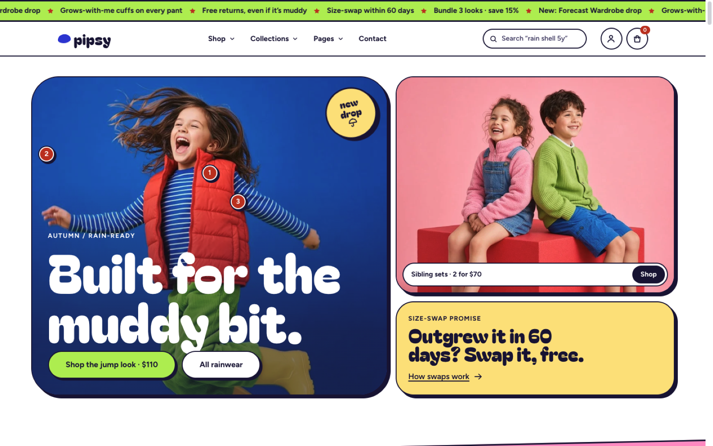

# Pipsy user guide

Pipsy is a Shopify theme for kids' clothing, ages 0 to 12. It is built around one idea: parents shop by their child's height and age, not by guesswork. Size ranges, height tiles, a height helper on the product page and a size guide fed by real store data all follow that idea, in a bright, playful look with big rounded type and colour bands.

This guide explains how to install Pipsy, set it up, and edit every page in the Shopify theme editor. Each page describes the real settings and blocks you see in the editor, with screenshots from the Pipsy demo store.

## Where to start

| If you want to… | Read |
| --- | --- |
| Know what Pipsy includes and what you need | [Introduction](getting-started/introduction.md) |
| Put the theme on your store | [Installation](getting-started/installation.md) |
| Get the store looking like the demo | [Setup checklist](getting-started/setup-checklist.md) and [Demo content](getting-started/demo-content.md) |
| Change colours, fonts, buttons or product cards | [Theme settings](theme-settings/overview.md) |
| Set up menus, the header and the footer | [Navigation menus](header-footer/navigation-menus.md) |
| Edit the home page | [Home page overview](home-page/overview.md) |
| Add reviews | [Product reviews (Judge.me)](product-page/reviews.md) |
| Create About, Contact, FAQs, Order tracking or Size guide | [Creating content pages](content-pages/creating-pages.md) |
| Fix something that does not look right | [FAQ and troubleshooting](reference/troubleshooting.md) |


Labels in this guide are the English labels of the theme editor. If your Shopify admin uses another language, the editor shows the same settings in that language, in the same order.


## Conventions

* **Customize** means **Online Store > Themes > Customize** on the Pipsy theme.
* **Theme settings** is the gear icon in the left bar of the theme editor.
* A **section** is a full-width band on a page. A **block** is an item inside a section (a tile, a slide, a question).
* Values written like `pipsy-main-shop` are handles or IDs you type exactly.
