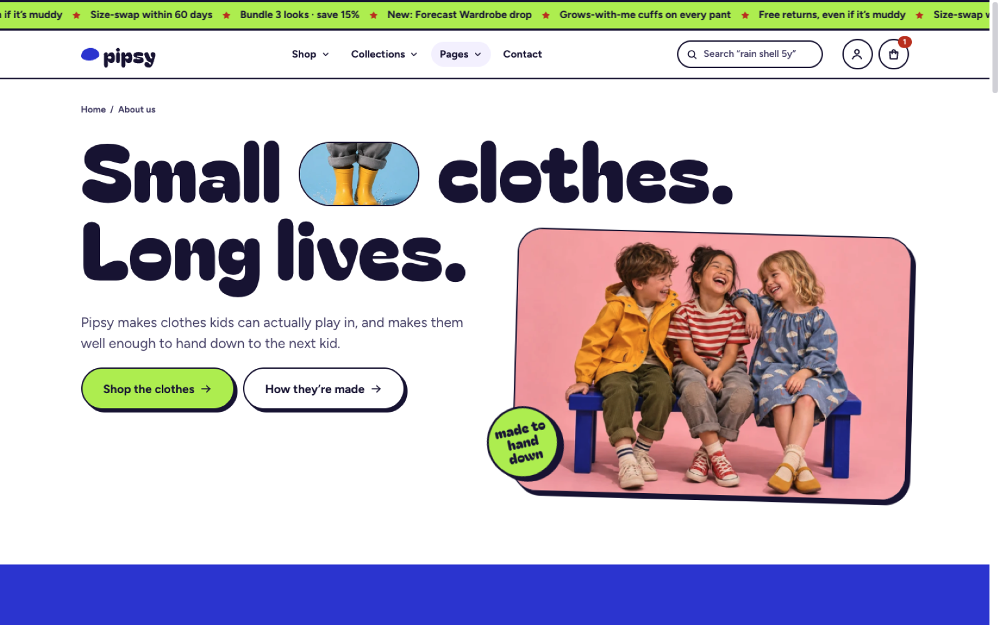

# About

Template **about**: the **About us** section with the **Colour bands** presentation, a stack of full-width chapters. The default **Page** section is included but hidden, so the page body from the admin is not shown.

## About us section

| Setting | Default | What it does |
| --- | --- | --- |
| Presentation | Colour bands (demo) | **Classic**, **Editorial** or **Colour bands**. Colour bands stack chapters: hero, statement, height bars, photo pairs, panels, invitation. |
| Section width | Boxed | |
| About page | | Only show on this page. Leave blank in a dedicated About template. |
| Color scheme, Enable motion, Card corner radius | | |
| Spacing | | Desktop and mobile padding. |

## Colour band blocks

| Setting | What it does |
| --- | --- |
| Gallery layout | **Hero**, **Image and text**, **Height bars**, **Photo and fact pairs**, **Two panels** or **Closing invitation**. |
| Eyebrow, Heading | In the heading, `[image]` places the small photo and `\|` starts a new line. |
| Heading level | Automatic (H1 for the hero, H2 elsewhere), H1, H2 or H3. Use one H1 per page. |
| Text, Image, Image description | |
| Small photo inside the heading / Raise photo beside the heading | |
| Button label / link, Secondary button label / link | |
| Anchor ID | For example `made`, so links like `/pages/about-us#made` jump here. |
| Sticker text | Round sticker on the hero. Wrap words in `[b]` and `[/b]` to put them on their own line. |
| Style | Color scheme, card, button, second button, hover, sticker color schemes, Heading scale. |

Each band can hold **Principle** blocks (Heading, Text, Sticker text, Large figure, Image, Link, Button label, Color scheme, Panel outline Solid/Dashed), used as height bars, photo-and-fact pairs or panels. A panel can list **Panel line** blocks (Icon, Text).
