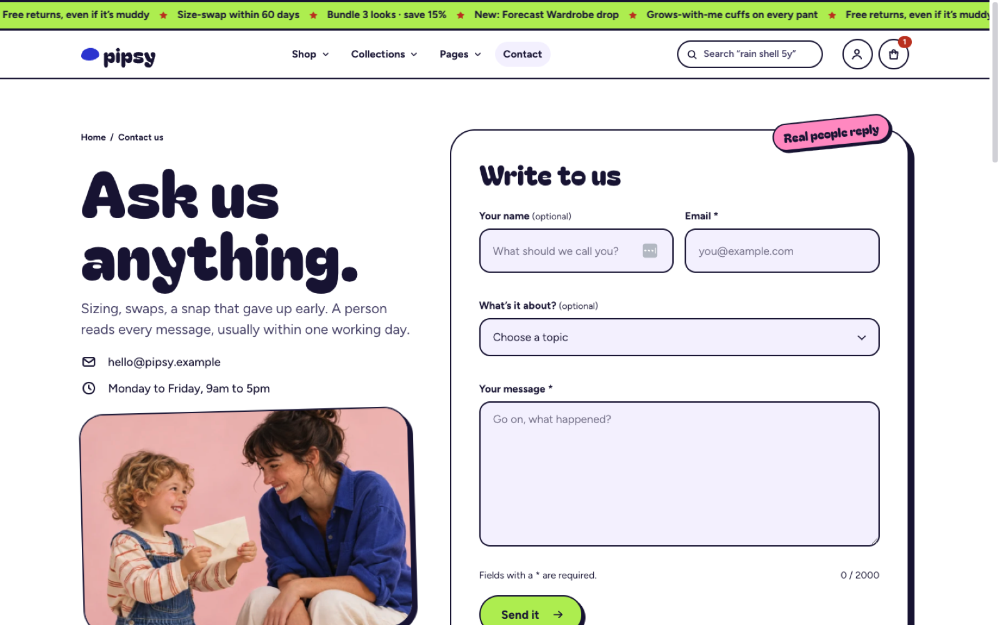

# Contact

Template **contact**: the **Contact page** section (intro, contact details, image and the form card, then shortcut tiles) and a **Closing card**.

## Contact page section

| Group | Settings |
| --- | --- |
| Content | Breadcrumb label, Eyebrow, Heading (blank = page title), Heading size, Introduction, **Email address**, **Opening hours**, Show page content (the page body from the admin), Jump link label / anchor ID / destination. |
| Image | Image, alt text, overlay label, label color scheme, caption start and end, desktop and mobile image ratio, **Show the image on mobile** (off keeps the form near the top), Sticker text and color scheme. |
| Layout | Section width, Color scheme, Heading scale, Card corner radius, spacing. |
| Shortcut tiles | Eyebrow, Heading, Color scheme, Card corner radius for the **Topic tile** blocks under the form (demo: "Probably quicker than an email." with Find their size, Swap a size, Where's my order?, Wash and care). |

## Contact form block

| Setting | What it does |
| --- | --- |
| Form layout | **Floating labels** or **Labels above fields, panel**. The panel layout adds a heading, message hint and character count. |
| Panel, field, button and button hover color schemes | |
| Form heading, Form introduction, Show required fields note | |
| Name label / placeholder, Email placeholder, Message label / placeholder / hint | |
| Require a message, Message character limit (0 = none), Show character count | |
| Button label, Show privacy policy link | The privacy link appears only when a privacy policy exists in **Settings > Policies**. |
| Size and padding | Width on desktop and mobile, padding. |

Inside the form you can add a **Topic selector** block (a dropdown sent as *Topic* with the message: Label, empty choice, Required, up to five options each with its own message hint) and **Custom field** blocks.


Messages are emailed to the store contact email set in your Shopify admin store details.

