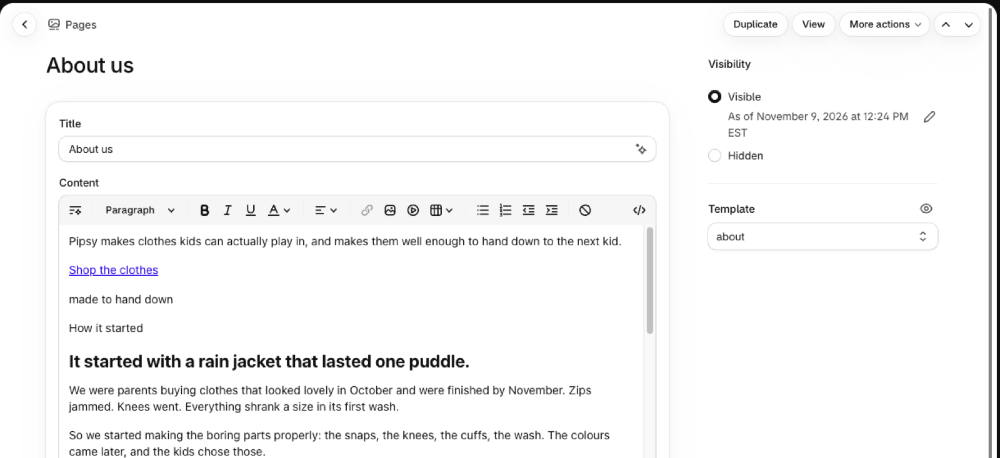
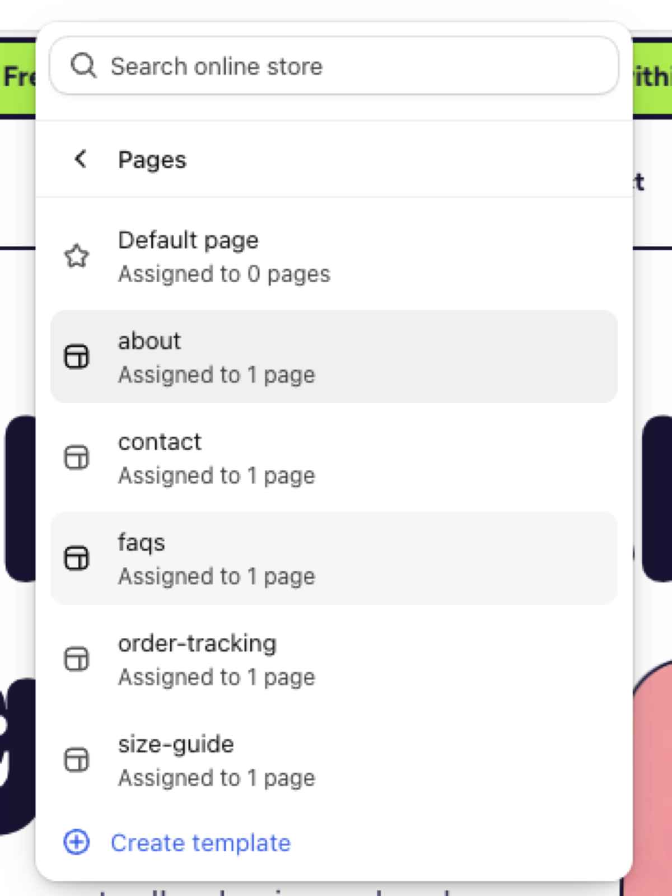

# Creating content pages

Pipsy has a ready-made template for each common store page. The page text and layout live in the **template** (edited in the theme editor); the page you create in the admin mainly gives the page its title and URL.

| Page | Template to assign | Suggested handle | Main sections |
| --- | --- | --- | --- |
| [About](about.md) | `about` (`page.about.json`) | `about-us` | About us (Colour bands) |
| [Contact](contact.md) | `contact` (`page.contact.json`) | `contact` | Contact page, Closing card |
| [FAQs](faqs.md) | `faqs` (`page.faqs.json`) | `faqs` | FAQ hub, Closing card |
| [Order tracking](order-tracking.md) | `order-tracking` (`page.order-tracking.json`) | `order-tracking` | Order help, Tile band, Questions with card |
| [Size guide](size-guide.md) | `size-guide` (`page.size-guide.json`) | `size-guide` | How to measure, Size guide, Closing card |
| Any other page | Default page (`page.json`) | | Page |

## Create a page and assign its template

1. In Shopify admin, go to **Online Store > Pages** and click **Add page**.
2. Enter a **Title** (for example "About us"). The content field can stay short or empty; see each page for what it uses.
3. In the right column, under **Template** (or **Theme template**), choose the matching template, for example **about**.

   
4. Make sure **Visibility** is **Visible**, then click **Save**.
5. Open **Customize**, choose **Pages** in the template menu at the top, and pick the template to edit its sections.

   


Keep the suggested handles (`about-us`, `faqs`, …) if you can. A few demo links in the templates jump to anchors on these pages, for example `/pages/faqs#faq-swaps` and `/pages/about-us#made`. Those anchored links are typed paths; if you use other handles, update them in the editor. See [How links behave](../reference/links.md).


## Shared building blocks

The content templates share some sections and blocks you can also add to other pages:

| Section or block | Use |
| --- | --- |
| **Closing card** | A big rounded card with a heading, text, image, **Icon line** and **Button** blocks. |
| **Tile band** | Up to 8 **Topic tile** blocks (icon or number, heading, text, button) on a coloured band. |
| **Questions with card** | Accordion questions on the left, a card with buttons on the right. |
| **Help accordion** | A heading with accordion questions. |
| **How to measure** | Numbered steps beside an image. |
| **Topic tile** | Icon (Ruler, Swap, Truck, Wash, Bag, Mail, Clock, Eye, Star, Rain, Drop, Leaf, Calendar, Question…) or a **Number**, Heading, Text, Button label, Link, Color scheme. |
| **Button** | Button label, Button link, Color scheme, Button hover color scheme. |

Most content sections offer **Heading scale** (70–150%) and **Card corner radius** in their Style group, and their own desktop and mobile padding.
