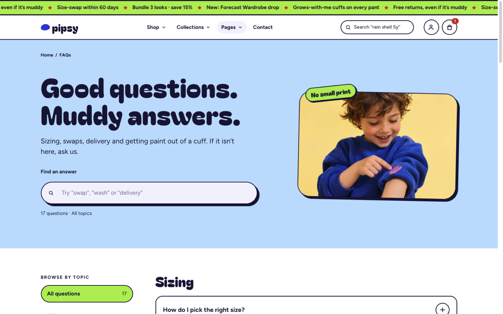

# FAQs

Template **faqs**: the **FAQ hub** (hero band with search, topic list and question groups) and a **Closing card**.

## FAQ hub section

| Group | Settings |
| --- | --- |
| Content | Breadcrumb label, Eyebrow, Heading, Heading size, Introduction, Show page content, Contact link label and link. |
| Search | Show search, Search label, Search placeholder, Field color scheme. The search filters questions as the shopper types and reports "N questions · All topics" or "Matching …". |
| Topic list | Show question counts, **Keep topic list in view on desktop**, Note heading and Note, Open only one question at a time, Enable motion. |
| Layout | Section width, Color scheme, spacing. |
| Hero band | Color scheme, Image, alt text, Sticker text and color scheme, Heading scale, Card corner radius. |
| Questions | Selected topic color scheme, Open question color scheme. |

## Blocks

* **Question group**: Heading (the topic name), Introduction, **Anchor ID** (for example `faq-swaps`, so `/pages/faqs#faq-swaps` jumps to it).
* **Question** (inside a group): Question, Answer, Answer link label, Answer link.

The demo has five groups: Sizing, Swaps and returns, Delivery, Washing and care, Materials.
