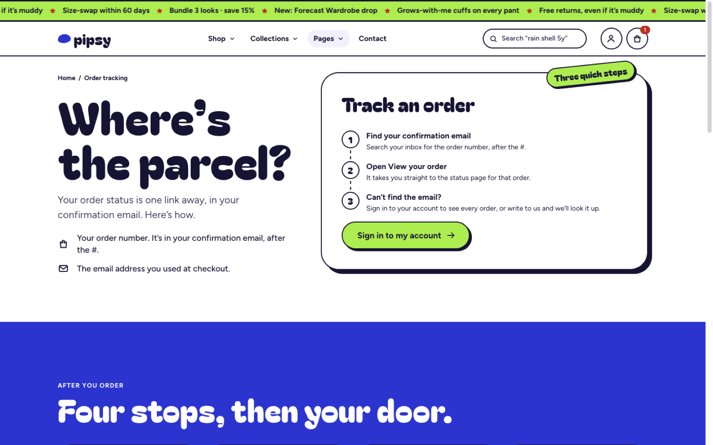

# Order tracking

Template **order-tracking**: **Order help** (hero with a three-step card), a **Tile band** with four numbered order stages, and **Questions with card**.


Shopify themes cannot look up an order from a number and email without an app. This page is a guide: it explains how to reach the order status page (linked in every confirmation email), shows signed-in customers a button to their latest order, and sends everyone else to their account. For a real tracking form, install an order tracking app and add its app block to this page.


## Order help section

| Setting | What it does |
| --- | --- |
| Breadcrumb label, Heading, Text | |
| Card heading, Sticker text and color scheme | The card on the right (demo: "Track an order", sticker "Three quick steps"). |
| Latest order button | Label of the button for signed-in customers, with color and hover schemes. |
| Account button | Label of the button for everyone else, with color and hover schemes. |
| Note below the buttons | |
| Style | Color scheme, card color scheme, width, heading scale, card radius, spacing. |

Blocks: **Icon line** (Icon, Text, Link) for the lines under the heading, and **Step** (Heading, Text) for the numbered steps in the card.

## Tile band and Questions with card

* **Tile band** ("Four stops, then your door."): four **Topic tile** blocks with a **Number** instead of an icon: Placed, Confirmed, Preparing, Complete.
* **Questions with card** ("If it's not going to plan."): **Question** blocks on the left; the card on the right ("Still can't find it?") holds **Button** blocks (Contact us, Read the FAQs). Settings: Eyebrow, Heading, Open only one question at a time, Anchor ID, Card heading and text, color schemes.
