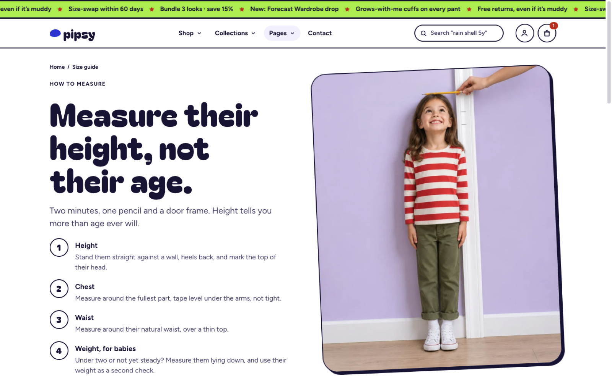
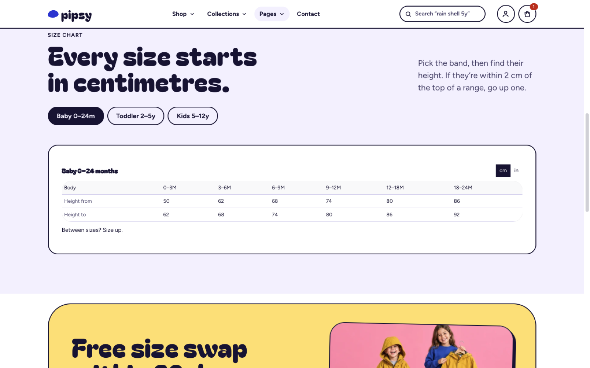

# Size guide

Template **size-guide**: **How to measure** (numbered steps beside a photo), **Size guide** (tabs with size charts) and a **Closing card** about the free size swap.

## How to measure

Eyebrow, Heading, Text, Image and alt text, Style (color scheme, width, heading scale, card radius), spacing. **Step** blocks (up to 6): Heading and Text. The demo steps are Height, Chest, Waist and Weight for babies.

## Size guide section

Eyebrow ("Size chart"), Heading ("Every size starts in centimetres."), Text, Style (color scheme, card color scheme, width, heading scale, card radius), spacing.

**Size band** blocks (up to 3) are the tabs:

| Setting | What it does |
| --- | --- |
| Title | Tab label, for example "Baby 0–24m". |
| Fallback table | One size per line, `label \| height`. Shown only until the matching `size_chart` metaobject exists. |

Each Size band holds a **Size chart** block. Set its **Metaobject handle** to `baby`, `toddler` or `kids` (or your own handles) to show the real chart. See [Size data](../product-page/size-data.md#create-the-size-metaobjects).


`size_chart` metaobjects need **Storefront access** on their definition, or the page keeps showing the fallback table.

