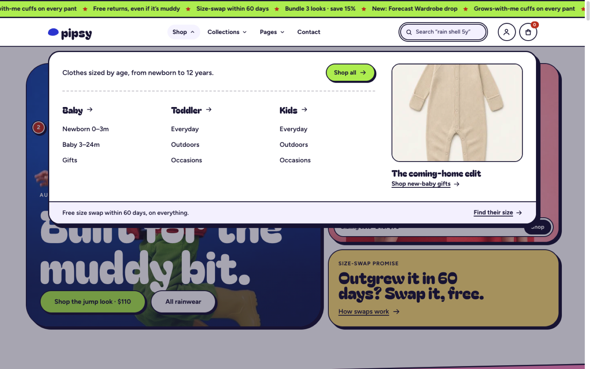

# Demo content

The Pipsy demo store shows the theme with a full kids' catalog. The theme ZIP contains the **layout and the demo texts in the templates**, but not the store data (products, collections, menus, pages, blog posts and size data). This page lists what the demo store holds, so you can rebuild the parts you need, and documents the importer the Pipsy team uses to create it.



## What the demo store contains

| Area | Demo data |
| --- | --- |
| Products | 24 products (16 active, 8 draft), 320 variants, 5 images each. Option 1 is **Colour**, option 2 is **Size**. |
| Product tags | `age:*`, `occasion:*`, `print:*` (for example `print:sunday-stripe`, `print:puddle-season`), `category:*` (`newborn`, `basics`, `family`, `grown-up`) and `new-in`. Collection rules read these tags and the product type. |
| Collections | 25 automated collections: `baby`, `toddler`, `kids`, `newborn`, `tops`, `bottoms`, `dresses`, `rompers`, `outerwear`, `sleepwear`, `accessories`, `basics`, `matching-family`, `grown-up`, `birthday`, `new-baby`, `everyday-play`, `just-because`, `gifts`, `gifts-under-30`, `gifts-under-60`, `sunday-stripe`, `puddle-season`, `new-in`, `sale`. |
| Collection metafields | `pipsy.intro` (rich text) and `pipsy.sticker_label` (single line). |
| Metaobjects | `size_range` (14 entries: one per size with height from/to), `size_chart` (3 entries: `baby`, `toddler`, `kids`), `colour_swatch` (29 entries). |
| Product metafields (namespace `pipsy`) | `age_band`, `fabric`, `grow_fact`, `fit_note`, `pack_count`, `print`, `size_chart`, `story_eyebrow`, `story_heading`, `story_intro`, `story_image`, `story_caption`, `details`, `promises`. |
| Menus | `pipsy-main-shop` (header: Shop, Collections, Pages, Contact), `pipsy-footer-shop`, `pipsy-footer-help`, `pipsy-footer-follow`, plus the older `pipsy-main`. |
| Pages | `about-us`, `contact`, `faqs`, `order-tracking`, `size-guide`, each assigned to its `page.*` template. |
| Blog | `journal` with 19 articles. |
| Files | About 140 images in **Content > Files** (product photos, home and page images, logo files). |


The demo images are for the demo only. Use your own product and lifestyle photos on your store.


## Rebuild the demo structure on your store

You do not need all of it. The parts that change how the theme behaves are the size data, the menus and the page templates.

1. **Size data (recommended).** In **Settings > Custom data**, create the metaobject definitions `size_range` and `size_chart` with **Storefront access** turned on, then add entries. Field lists are in [Size data](../product-page/size-data.md).
2. **Product metafields (optional).** In **Settings > Custom data > Products**, add definitions in the namespace set in **Theme settings > Size data > Metafield namespace** (default `pipsy`). The most useful one is `size_chart` (metaobject reference to `size_chart`).
3. **Collections.** Create automated collections with tag conditions, for example *Product tag is equal to* `age:baby`. Use handles that match your home page links, or re-pick the links in the editor.
4. **Menus.** See [Navigation menus](../header-footer/navigation-menus.md) for the structure the header and footer expect.
5. **Pages.** See [Creating content pages](../content-pages/creating-pages.md).
6. **Blog.** Create a blog (the demo uses the handle `journal`) and add articles with tags; the tags become the topic chips. See [Journal](../more-pages/journal.md).

## The demo importer (Pipsy team)

The theme source includes the generator and importer that built the demo store. It is a maintenance tool, documented in `docs/demo-data.md` of the source folder. It is **locked to the Pipsy demo store**: it reads the store from the `dev` environment in `shopify.theme.toml` and refuses any other store.

**Generate files (no store access):**

```bash
node scripts/build-pipsy-products.mjs
node scripts/build-pipsy-content.mjs
node --test tests/pipsy-data.test.mjs
```

These write `scripts/pipsy-data/products.csv`, the metaobject definitions and entries, `collections.json`, `menus.json`, `pages.json` and the blog post data.

**Preview the store writes (no store access):**

```bash
node scripts/import-pipsy-metaobjects.mjs --dry-run --step all
```

A dry run prints every GraphQL operation and writes a receipt to `scripts/pipsy-data/receipts/`. Nothing is sent to Shopify.

**Write to the store** (`--apply`). Each of these steps **creates data on the store**. Run them only with the store owner's approval, after `shopify store auth` for the store:

| # | Step | Writes |
| --- | --- | --- |
| 1 | `--apply --step definitions` | 3 metaobject definitions, 16 metafield definitions |
| 2 | `--apply --step entries` | Size range, size chart and colour swatch entries |
| 3 | `--apply --step files` | Images uploaded to Content > Files |
| 4 | `node scripts/build-pipsy-products.mjs --image-map scripts/pipsy-data/receipts/files-map.json` | Local file only: `products.import.csv` with CDN image URLs |
| 5 | Admin **Products > Import** with `products.import.csv` | Products (done by hand in the admin) |
| 6 | `--apply --step links` | Size chart reference and age band list on each product |
| 7 | `--apply --step collections` | Collections, published to the Online Store |
| 8 | `--apply --step menus` | Menus |
| 9 | `--apply --step blog` | Blog and articles |
| 10 | `--apply --step pages` | Pages |
| 11 | `--apply --step templates` | Template assignment on the pages (needs the Pipsy theme published) |

Every step skips what already exists, so a failed run can be repeated. Page templates can also be set with `node scripts/set-pipsy-page-templates.mjs` (dry run by default, `--apply` to write, `--restore` to undo).


The demo catalog prices are plain numbers (12–58). Set your store currency before judging how prices look.

