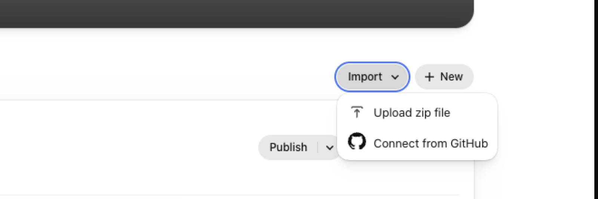
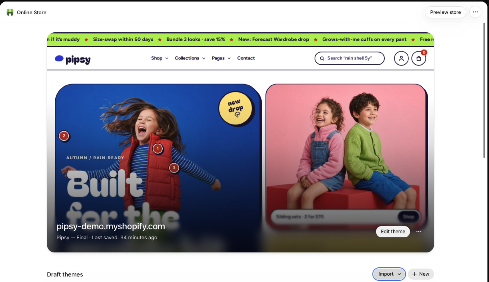
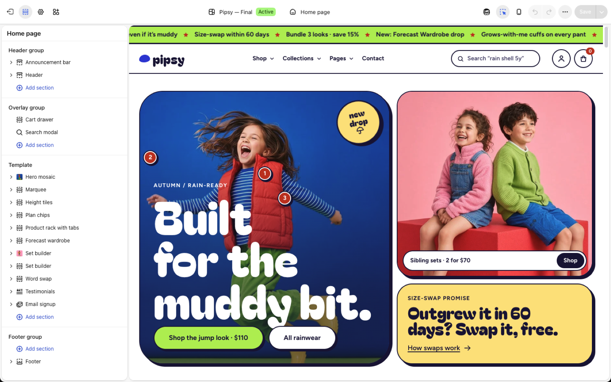

# Installation

You can install Pipsy by uploading the theme ZIP in the Shopify admin, or by pushing the theme folder with Shopify CLI. Both install the theme as a **draft** (unpublished) so you can set it up before customers see it.

## Option 1: Upload the ZIP in Shopify admin

1. In Shopify admin, go to **Online Store > Themes**.
2. Scroll to **Draft themes** (called *Theme library* in some admin versions) and click **Import** (or **Add theme**).
3. Choose **Upload zip file**.

   
4. Select the Pipsy ZIP file and click **Upload file**. Do not unzip it first.
5. Wait until the upload finishes. Pipsy appears in the draft list.


Upload the theme ZIP itself, not a download bundle that contains the ZIP plus documentation. If Shopify says the file is missing `layout/theme.liquid`, you uploaded the wrong file.


## Option 2: Push with Shopify CLI

Use this if you work from the Pipsy source folder (for example to keep your own changes in Git).

1. Install [Shopify CLI](https://shopify.dev/docs/api/shopify-cli) and Node.js.
2. Open a terminal in the theme folder and install the build tools:

   ```bash
   npm ci
   npm run build
   ```

   `npm run build` compiles the source styles in `src/` into `assets/theme.css` and the section stylesheets. The ZIP and the store only need the compiled files.
3. Push the theme to your store as a new unpublished theme:

   ```bash
   shopify theme push --unpublished --store your-store.myshopify.com
   ```

   The CLI opens a browser to log in the first time and asks for a name for the new theme.


Always push with `--unpublished` for a first install. Pushing to your live theme replaces its files and its settings at once.


To preview local changes while you work, run `shopify theme dev --store your-store.myshopify.com`. It serves a temporary development theme and reloads on save.

## Build the ZIP yourself

From the source folder:

```bash
npm ci
npm run build
npm run package
```

`npm run package` runs `shopify theme package`, which writes a ZIP of the theme folders into the project folder. Files listed in `.shopifyignore` (the source styles in `src/`, `scripts/`, `docs/`, `tests/` and project notes) are not part of the theme.

## Preview the theme

1. In **Online Store > Themes**, find Pipsy in the draft list.
2. Click **…** (actions) **> Preview** to open your store with Pipsy without publishing it.
3. Click **Customize** (or **Edit theme**) to open the theme editor.





## Publish

When the theme is ready, open **…** next to Pipsy in the draft list and choose **Publish**. Your previous theme moves to the draft list, with its settings kept, so you can switch back at any time.


Before publishing, work through the [Setup checklist](setup-checklist.md): logo, menus, colour schemes, a review app, and the content page templates.

