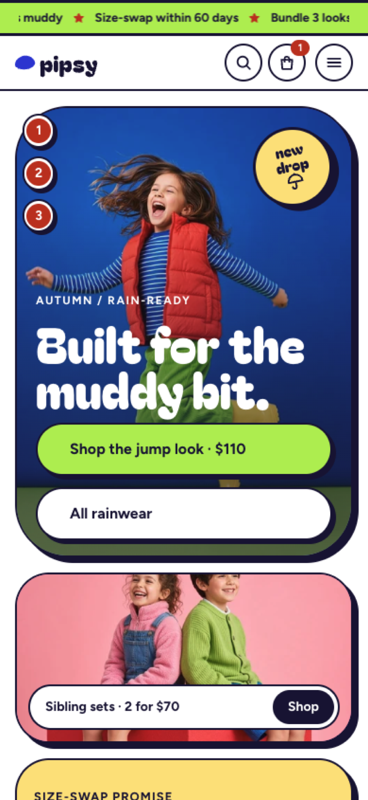

# Introduction

Pipsy is a Shopify Online Store 2.0 theme by Novaworks for kids' fashion stores (ages 0–12). It pairs a bold, sticker-and-colour-band look (Bagel Fat One headings, Figtree body text, Ink, Lime, Cobalt, Bubble, Butter, Sky and Mist colour schemes) with tools that help parents pick the right size.

## Feature overview

**Size help everywhere**

* Size range badge on the product page ("Sizes 2–12Y · 92–152 cm") built from the product's size option.
* Size buttons that show the child's height under each age size.
* [Height helper](../product-page/size-data.md): the shopper types a height and the matching size is selected.
* [Size guide page](../content-pages/size-guide.md) with tabs that read real `size_chart` metaobjects.
* [Height tiles](../home-page/height-tiles.md) on the home page that link each age band to its collection.

**Home page sections built for the niche, with neutral names**

[Hero mosaic](../home-page/hero-mosaic.md) with product pins, [Marquee](../home-page/marquee.md) tape, [Height tiles](../home-page/height-tiles.md), [Plan chips](../home-page/plan-chips.md), [Product rack with tabs](../home-page/product-rack.md), [Forecast wardrobe](../home-page/forecast-wardrobe.md), [Set builder](../home-page/set-builder.md) (outfit and step bundles), [Word swap](../home-page/word-swap.md), [Testimonials](../home-page/testimonials.md) with a scroll collage, and [Email signup](../home-page/email-signup.md).

**Shopping**

* Catalog with sidebar filters, colour swatches, size chips on each card, [quick view](../shopping/quick-view-and-cards.md) and an "add" pill.
* [Cart drawer](../header-footer/drawers-and-popup.md) and [cart page](../shopping/cart.md) with order note, discount code and shipping estimate cards.
* Predictive [search drawer](../shopping/search.md) with popular searches and collection shortcuts.
* Mega menu with a photo card, mobile drawer with nested branches.

**Content**

Ready-made templates for [About](../content-pages/about.md), [Contact](../content-pages/contact.md), [FAQs](../content-pages/faqs.md), [Order tracking](../content-pages/order-tracking.md), [Size guide](../content-pages/size-guide.md), the [Journal](../more-pages/journal.md) blog, [customer accounts](../more-pages/customer-accounts.md), a [gift card](../product-page/gift-card.md) page, a [password page and 404](../more-pages/password-and-404.md).

**Reviews**

A [Reviews band](../product-page/reviews.md) on the product page that hosts a reviews app block (set up for the free Judge.me plan) and shows a summary card, plus star ratings on product cards and the product title.

**Five languages**

English (default), German, Spanish, French and Italian. See [Translations](../reference/translations.md).

## Requirements

| What | Needed for |
| --- | --- |
| A Shopify store on any plan with the Online Store sales channel | Everything |
| Products with a **Size** option (for example `2–3Y`, `0–3M`) | Size range badge, size buttons with heights, height helper, set builder |
| A **Colour** option | Colour swatches on cards and the product page |
| Shopify **Search & Discovery** app (free, by Shopify) | Choosing which filters show on collection and search pages |
| A product reviews app (the theme is set up for **Judge.me**, free plan) | Reviews band and star ratings — optional |
| Shopify CLI and Node.js | Only if you install from the source code or build the ZIP yourself |


The theme never invents product data. When a product has no size option, no ratings or no size chart, the related element simply does not show.


## What is in the package

The theme ZIP holds the standard Shopify folders: `assets`, `blocks`, `config`, `layout`, `locales`, `sections`, `snippets` and `templates`. The demo products, collections, menus and pages are **not** part of the theme ZIP; see [Demo content](demo-content.md).

Next: [Installation](installation.md).
