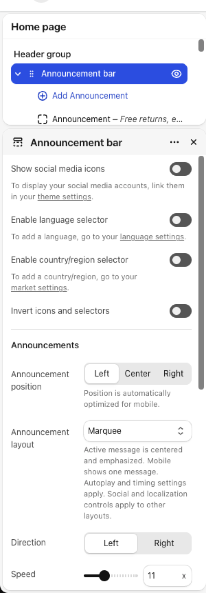

# Announcement bar

The announcement bar is the first section of the **Header group**. In the demo it is a Lime strip with five messages scrolling as a marquee, separated by stars.

## Section settings

| Setting | Default (demo) | What it does |
| --- | --- | --- |
| Show social media icons | On (demo: off) | Social icons from Theme settings > Social media. |
| Enable language selector / Enable country/region selector | On (demo: off) | Pickers appear only when the store has more than one language or market. |
| Invert icons and selectors | Off | Swaps their side. |
| Announcement position | Center (demo: Left) | Left, Center or Right. Optimised automatically on phones. |
| Announcement layout | Carousel (demo: Marquee) | **Carousel** (one message at a time), **Marquee** (continuous scroll) or **Centered slider**. |
| Auto-rotate announcements / Change every | On, 5 s | For Carousel and Centered slider. |
| Show navigation | Off | Arrows for the carousel. |
| Direction / Speed | Left, 20 (demo 11) | For Marquee. |
| Band style | Plain (demo: Flat strip) | Plain or Flat strip. |
| Separator style | Dot (demo: Star) | Dot or Star between marquee messages. |
| Color scheme | Scheme 2 (demo: Scheme 6, Lime) | |
| Do not show on home page | Off | |
| Section width | Boxed (demo: Full width) | |
| Enable border bottom | Off | |

## Announcement blocks

Up to 6. Each has **Icon**, **Text**, **Link**, and a **Mobile layout** group with **Hide icon on mobile** and **Text on mobile** (a shorter text for phones).

Demo messages: "Free returns, even if it's muddy", "Size-swap within 60 days", "Bundle 3 looks · save 15%", "New: Forecast Wardrobe drop", "Grows-with-me cuffs on every pant".
