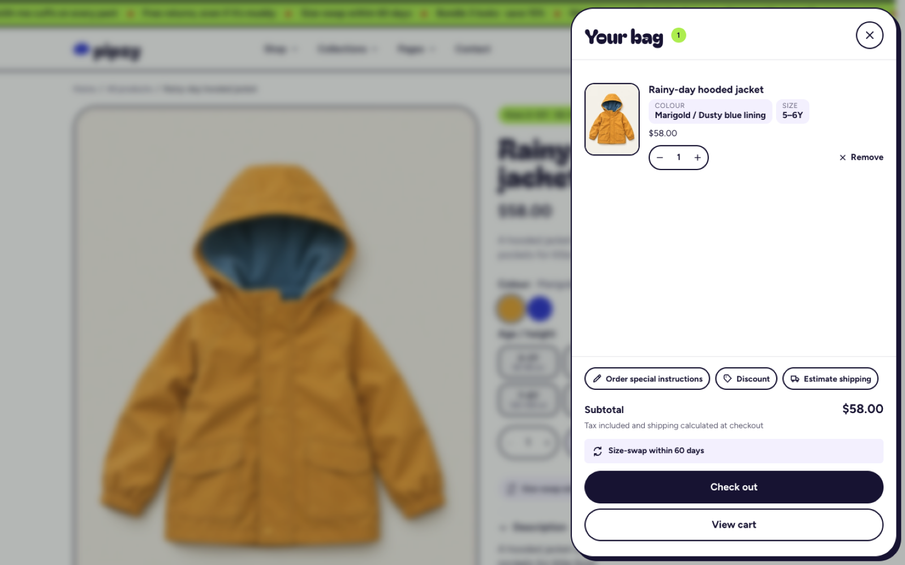
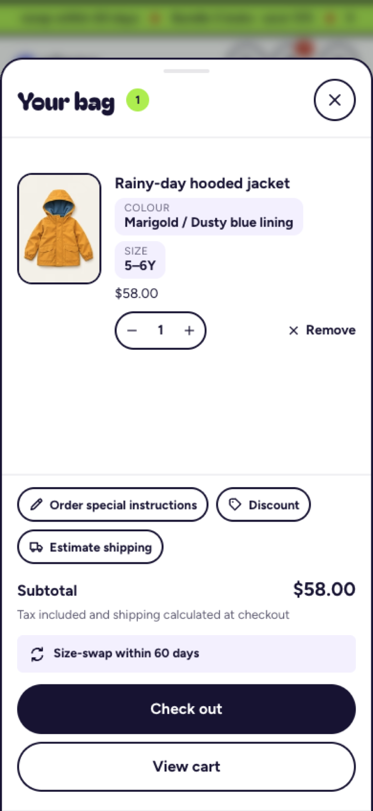
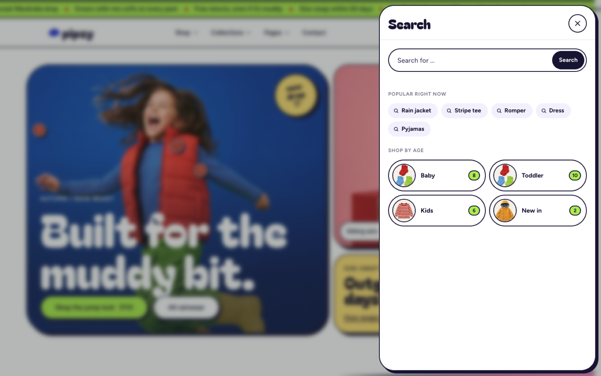

# Cart drawer, search drawer and popup

The **Overlay group** (visible in the editor section list on every page) holds the sections that open over the page: **Cart drawer**, **Search modal** and, if you add it, **Popup**.

## Cart drawer

Opens when a product is added (with **Theme settings > Cart > Cart type** set to Drawer) and from the bag button.

| Setting | Default | What it does |
| --- | --- | --- |
| Heading | "Your bag" | |
| Width | 520 px | 380–640 px on desktop. |
| Show vendor | On | |
| Show cart note | On | "Order special instructions" pill. |
| Show shipping rates calculator | On | "Estimate shipping" pill. |
| Allow discounts in cart | On | "Discount" pill. |
| Show view cart button / Show checkout button | On / On | |
| Show accelerated buttons | Off | Express checkout buttons (Shop Pay, Apple Pay…), when set up in Settings > Payments. |
| Promise line > Icon, Text | Swap, "Size-swap within 60 days" | Shown above the checkout buttons. Empty hides it. |
| Color scheme | Scheme 3 | |
| Free shipping bar > Show free shipping bar | Off | A progress bar towards free shipping. |
| Free shipping minimum amount | 100 | Number only; for several currencies, `USD:100, EUR:95`. |
| Cart recommendations | On, "Explore other products", 5 | Dynamic recommendations, or your own **Curated recommendations** list. |
| Empty cart recommendations | "Your bag is empty." | Text and a collection list for an empty bag. |
| Recently viewed products | Off | |

## Search modal (search drawer)

Opens from the header search field.

| Setting | Default | What it does |
| --- | --- | --- |
| Color scheme | Scheme 1 | |
| Width | 520 px | 380–640 px. |
| Popular searches > Heading, Search terms | "Popular right now"; "Rain jacket, Stripe tee, Romper, Dress, Pyjamas" | Comma-separated terms; each links to its search results. |
| Collection shortcuts > Heading, Discovery collections | "Shop by age" | Round collection shortcuts with product counts. |
| Recommended products > Heading, Products | "Popular picks" | Optional product list under the shortcuts. |

## Popup

Add **Popup** to the Overlay group with **Add section** for a newsletter or promo popup.

| Setting | Default | What it does |
| --- | --- | --- |
| Delay | 5 s | |
| Show again | Once a week | Once per session, once a day or once a week. |
| Show on home page only | Off | |
| Hide for signed-in customers | Off | The editor always shows the popup so you can edit it. |
| Image / Image position | Left | Left, Right, Top or None. |
| Accessibility | "Newsletter sign-up" | Name read by screen readers. |
| Color scheme | Scheme 1 | |

The popup content is made of theme blocks (heading, text, newsletter, button…) or app blocks.
