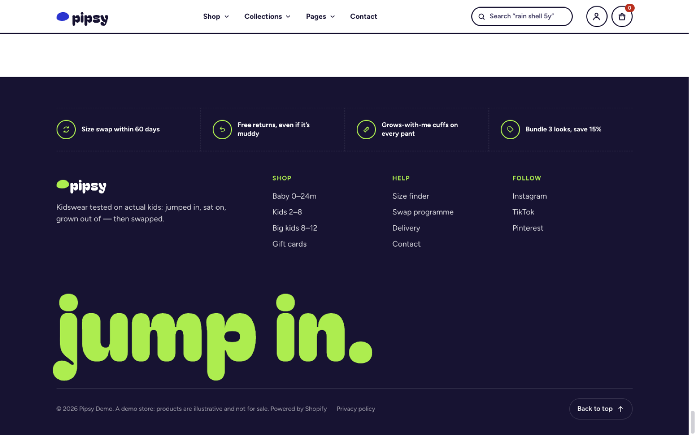
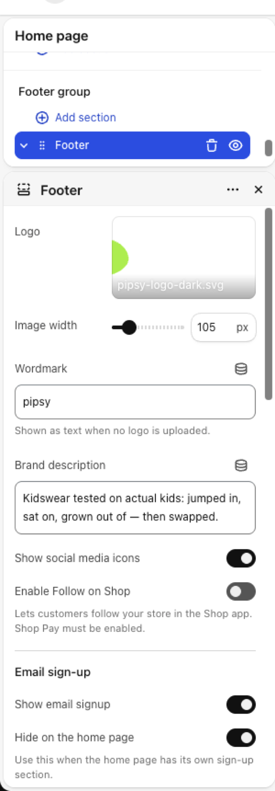

# Footer

The footer is the **Footer** section in the **Footer group**: a dark Ink band with a promise row, the logo and tagline, menu columns, a large closing line and a legal row.

## Section settings

| Setting | Default (demo) | What it does |
| --- | --- | --- |
| Logo / Image width | Demo: light logo file, 105 px | Footer logo (40–400 px). Without it the **Wordmark** text shows. |
| Wordmark | `pipsy` | |
| Brand description | Demo: "Kidswear tested on actual kids: jumped in, sat on, grown out of — then swapped." | Tagline under the logo. |
| Show social media icons | On | Round icons for the accounts filled in Theme settings > Social media. |
| Enable Follow on Shop | Off | Lets customers follow the store in the Shop app (needs Shop Pay). |
| Email sign-up > Show email signup | On | A Lime sign-up card above the footer columns. |
| Hide on the home page | On | Use when the home page has its own sign-up section. |
| Heading / Text / Button label | "Get the Pipsy Post" / … / "Sign up" | Card texts. |
| Large closing line | Demo: "jump in." | Big display text under the menus. Empty hides it. |
| Legal row > Show copyright | On | |
| Additional copyright text | Demo: "A demo store: products are illustrative and not for sale." | **Change this on your store.** |
| Show policy links | On | Links to the policies in Settings > Policies. |
| Show payment icons | On | Icons of your active payment methods. |
| Enable country/region selector / language selector | On | Shown only when the store has several markets or languages. |
| Show back to top | On | A "Back to top" pill in the legal row. |
| Color scheme | Scheme 2 (Ink) | |

On pages other than the home page, the Lime sign-up card sits at the top of the footer, above the promise row.

## Blocks

| Block | Settings | Notes |
| --- | --- | --- |
| **Promise** | Icon (Return, Exchange, Ruler, Truck, Package, Tag, Gift, Heart, Star, Wash, Leaf, Lock, Mail, Clock, Globe or None), Text | The row of round icons across the top. The demo has four: size swap, free returns, grows-with-me cuffs, bundle offer. Four across on desktop, 2 × 2 on tablets and phones. |
| **Menu group** | Heading, Choose a menu | One column per block. Shows top-level items only. See [Navigation menus](navigation-menus.md#footer-menus). |
