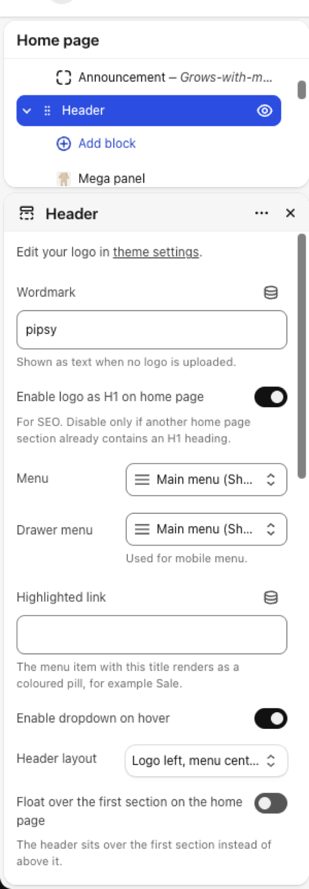
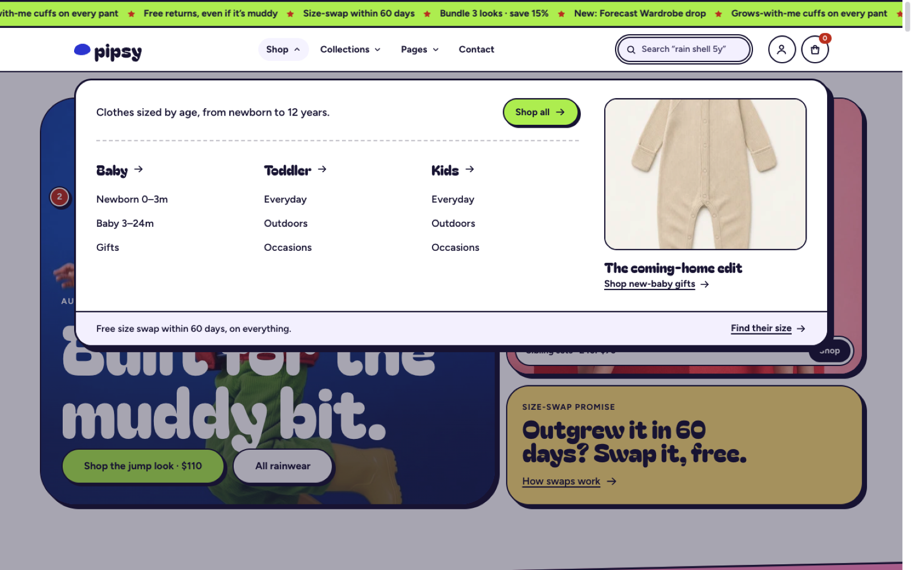
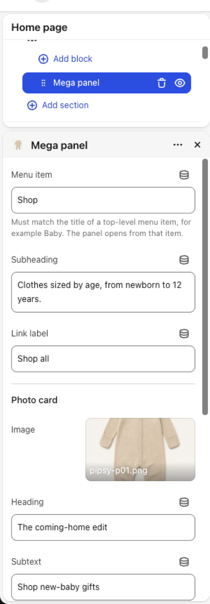

# Header and mega menu

The **Header** section sits under the announcement bar in the **Header group**. It holds the logo, the main menu, the search field, the account button and the bag button.

## Header settings

| Setting | Default (demo) | What it does |
| --- | --- | --- |
| Wordmark | `pipsy` | Text shown when no logo is uploaded in Theme settings > Logo. |
| Enable logo as H1 on home page | On | SEO: the logo is the home page H1. |
| Menu | `main-menu` (demo: `pipsy-main-shop`) | Desktop menu. |
| Drawer menu | Blank (demo: `pipsy-main-shop`) | Mobile drawer menu. |
| Highlighted link | `Sale` (demo: blank) | Title of a top-level item shown as a coloured pill. |
| Enable dropdown on hover | On | Off opens menus on click. |
| Header layout | Logo left, menu center | Or **Navigation left, wordmark centre**. |
| Float over the first section on the home page | Off | Header overlays the first home section. |
| Sticky header | Always | None, On scroll up, or Always. |
| Header icons > Search placeholder | Demo: `Search "rain shell 5y"` | Text in the header search field. |
| Show account icon | On | |
| Header action menu > Show action menu on desktop | On (demo: off) | A small menu with language, country and appearance pickers. |
| Enable language selector / country selector / Show country name / Show country flag / Show appearance presets on desktop | | Options of the action menu. |
| Mobile layout > Enable accordion menu | Off | Opens sub-menus in place instead of sliding branches. |
| Mobile layout > Show social media icons, language selector, country selector, appearance | | Extras at the bottom of the drawer. |
| Color scheme | Scheme 1 | |

## Mega panel blocks

Add a **Mega panel** block to the Header for each top-level menu item that should open a large panel instead of a small dropdown.

| Setting | What it does |
| --- | --- |
| Menu item | Must match the **title** of a top-level menu item exactly, for example `Shop`. The panel opens from that item. |
| Subheading | Line at the top left (demo: "Clothes sized by age, from newborn to 12 years."). |
| Link label | Text of the pill that links to the item's own URL (demo: "Shop all"). |
| Photo card > Image, Heading, Subtext, Link | The card on the right (demo: "The coming-home edit", linking to the `new-baby` collection). |
| Bottom strip > Text, Link label, Link | The strip along the bottom (demo: "Free size swap within 60 days, on everything." / "Find their size"). |

The panel's columns come from the menu: each child of the item becomes a column heading, and its own children are listed under it.


If you rename a menu item, update the **Menu item** setting of its mega panel, or the item falls back to a normal dropdown.

