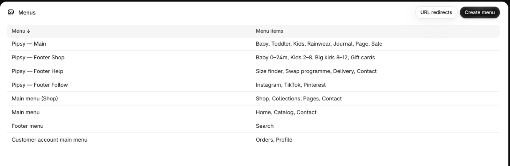
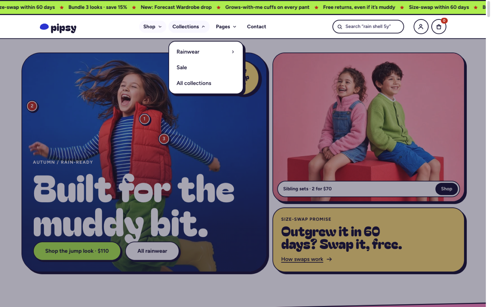
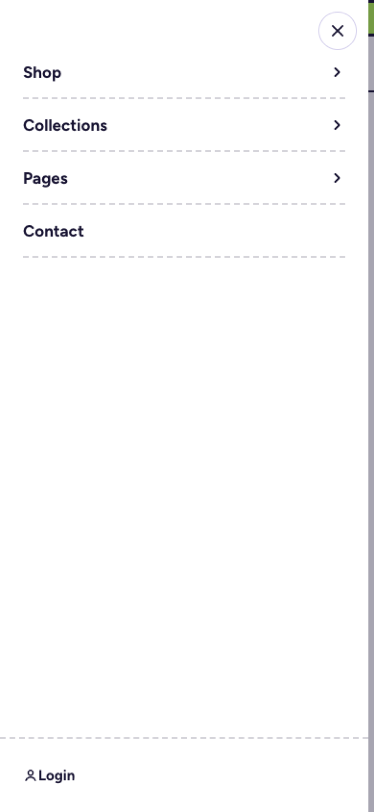
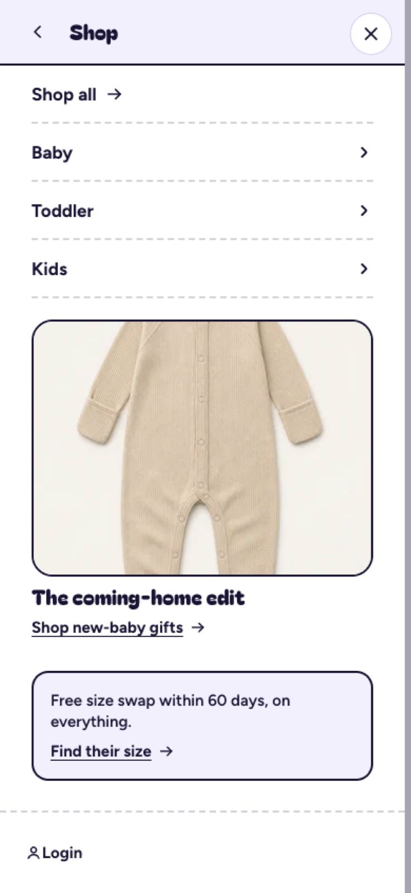

# Navigation menus

Menus are created in Shopify admin under **Content > Menus** (older admin: **Online Store > Navigation**) and then chosen in the Header and Footer sections. Pipsy does not need special menu handles: it uses whatever menu you pick.

## Menus the theme uses

| Where | Setting | Default | Demo menu |
| --- | --- | --- | --- |
| Header, desktop | Header > **Menu** | `main-menu` | `pipsy-main-shop` |
| Header, mobile drawer | Header > **Drawer menu** | Same as Menu when blank | `pipsy-main-shop` |
| Footer columns | Footer > **Menu group** block > **Choose a menu** | `footer` | `pipsy-footer-shop`, `pipsy-footer-help`, `pipsy-footer-follow` |
| Customer account area | Theme settings > Customer accounts > **Customer account menu** | `customer-account-main-menu` | Shopify's default |
| Search suggestions | Theme settings > Search > **Search recommendation**, Search results > **Search recommendation** | Blank | Blank |

## Main menu structure

Shopify menus have up to three levels. The demo main menu has four top-level items:

* **Shop** → `/collections/all`, with Baby, Toddler and Kids, each with Everyday, Outdoors, Occasions (and Newborn, Baby 3–24m, Gifts under Baby). A **Mega panel** block named "Shop" turns this item into the large panel.
* **Collections** → `/collections`, with Rainwear (and its sub-items), Sale and All collections. Opens a dropdown card.
* **Pages** → About Us, FAQs, Order tracking, Size guide, Journal. Opens a dropdown card.
* **Contact** → the Contact page.

On phones the same menu opens in the drawer. Items with children open a branch with a back arrow; a branch with a mega panel shows the panel's link label ("Shop all"), its photo card and its bottom strip.


**Highlighted link** in the Header section turns one top-level item into a coloured pill. Type the item's exact title, for example `Sale`. The demo leaves it empty.


## Footer menus

Footer **Menu group** blocks show only the **top-level items** of the menu you choose. The demo uses three short menus:

| Menu | Items |
| --- | --- |
| `pipsy-footer-shop` | Baby 0–24m, Kids 2–8, Big kids 8–12, Gift cards |
| `pipsy-footer-help` | Size finder, Swap programme, Delivery, Contact |
| `pipsy-footer-follow` | Instagram, TikTok, Pinterest |

The block's **Heading** replaces the menu title; leave it empty to use the menu title.
