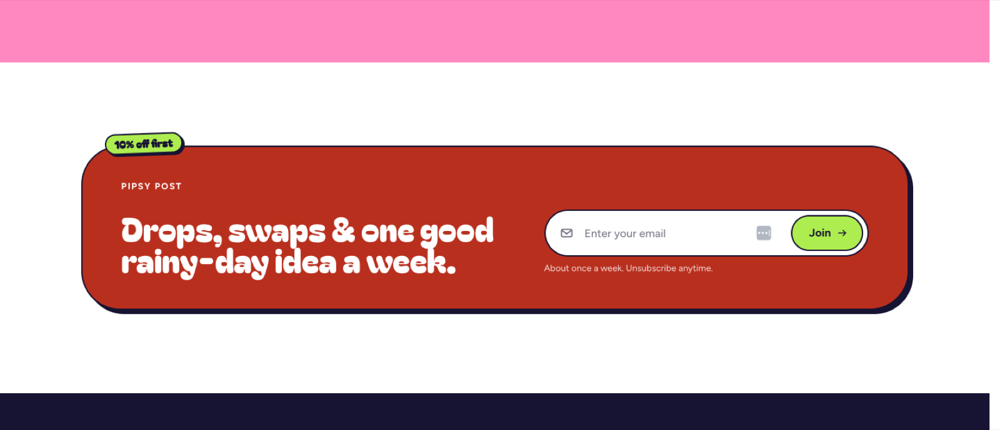

# Email signup

"Pipsy Post": the newsletter card at the end of the home page. Subscribers are added to your customer list with *accepted marketing*.

## Section settings

| Setting | Default (demo) | What it does |
| --- | --- | --- |
| Section width | Boxed | |
| Desktop content width / alignment, Mobile content alignment | Medium, Left | |
| Card ground | No card (demo: Sale ground card) | No card, Ink card, Lilac card or Sale ground card. |
| Eyebrow | Demo: "Pipsy Post" | |
| Sticker text | Demo: "10% off first" | Tilted sticker on the card. |
| Show a visible field label | Off (demo: on) | |
| Submit button text | Demo: "Join" | Blank shows an arrow icon. |
| Color scheme, padding, Make section narrow | | |

## Blocks

Heading, Text, Button, Link, Icon, Image, **Form** (one), Social media icons, Empty space, Custom Liquid and app blocks. The demo uses Heading ("Drops, swaps & one good rainy-day idea a week."), Form and Text ("About once a week. Unsubscribe anytime.").


The footer has its own sign-up card. Its **Hide on the home page** setting is on, so the home page shows only this section.

