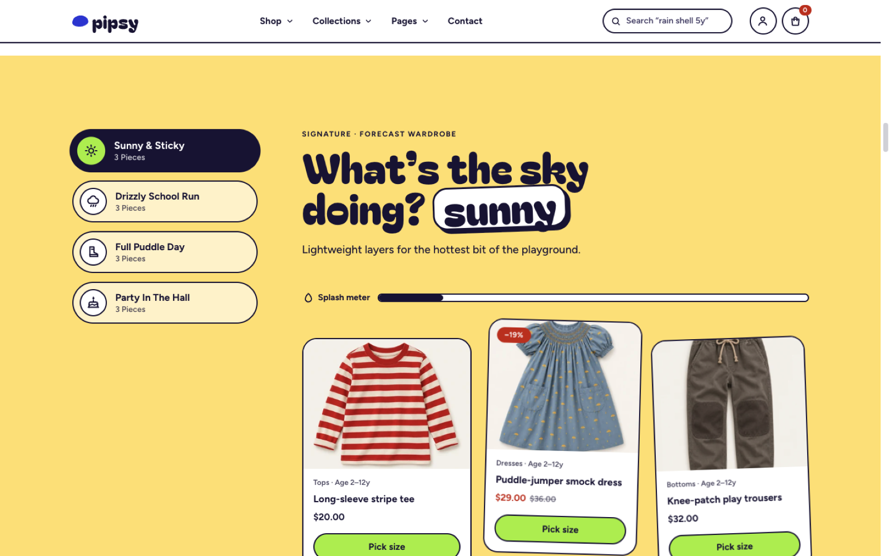
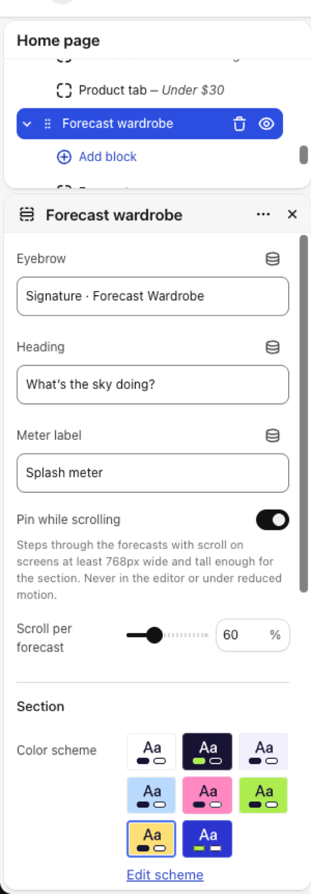

# Forecast wardrobe

"What's the sky doing?": weather tabs on the left; each forecast shows an accent word in the heading, a short text, a "splash meter" and up to three products.

## Section settings

| Setting | Default | What it does |
| --- | --- | --- |
| Eyebrow | "Signature · Forecast Wardrobe" | |
| Heading | "What's the sky doing?" | The forecast's accent word is added in a pill. |
| Meter label | "Splash meter" | |
| Pin while scrolling | On | Steps through the forecasts as the shopper scrolls, on screens at least 768 px wide and tall enough. Never in the editor or with reduced motion. |
| Scroll per forecast | 60% | 20–150% of the screen height per step. |
| Section group | Scheme 7 | |

## Forecast blocks (up to 6)

| Setting | Default | What it does |
| --- | --- | --- |
| Tab label | "Sunny & sticky" | |
| Icon | Sun | Sun, Rain, Boot, Cake, Umbrella, Drop, Moon, Leaf, Heart, Star, Gift, Wash. |
| Accent word | "sunny" | Shown in the heading pill. |
| Description | | |
| Meter value | 15% | Fill of the splash meter. |
| Band colour scheme | Scheme 7 | Background while this forecast is active. |
| Products (up to 3) | | |
| Button label / Button link | "Shop this forecast" | |
