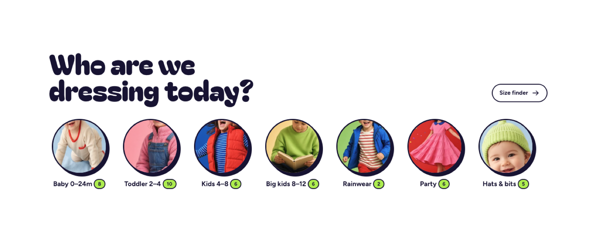

# Height tiles

Age or height shortcuts that link to collections. The demo shows them as **Round chips** with a product count.

## Section settings

| Setting | Default | What it does |
| --- | --- | --- |
| Eyebrow | "Shop by height" | |
| Heading | "Who are we dressing today?" | |
| Heading link label / Link | "Size finder" | Pill next to the heading (demo: the Size guide page). |
| Presentation | Height tiles | **Height tiles** (cards with the height range) or **Round chips**. |
| Number of columns on desktop | 6 | 2–6. |
| Section group | | Color scheme, width, padding, heading scale, corner radius. |

## Height tile blocks (up to 8)

| Setting | What it does |
| --- | --- |
| Height range | For example "92–104 cm" (tile presentation). |
| Age | For example "2–4Y" or "Baby 0–24m". |
| Short line | For example "Toddlers". |
| Image | Photo in the tile or chip. |
| Collection | Sets the link when **Link** is empty and shows the product count. |
| Link | Overrides the collection link. |
| Color scheme | Ring or card colour. |
