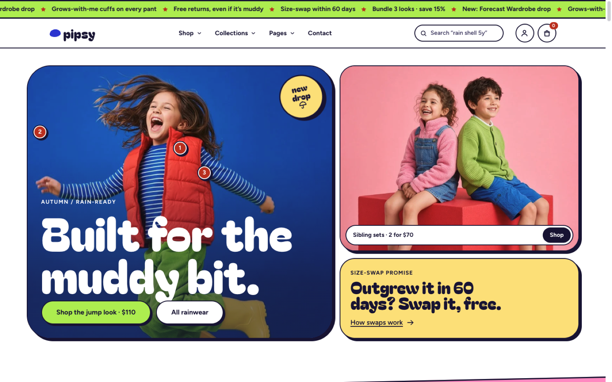
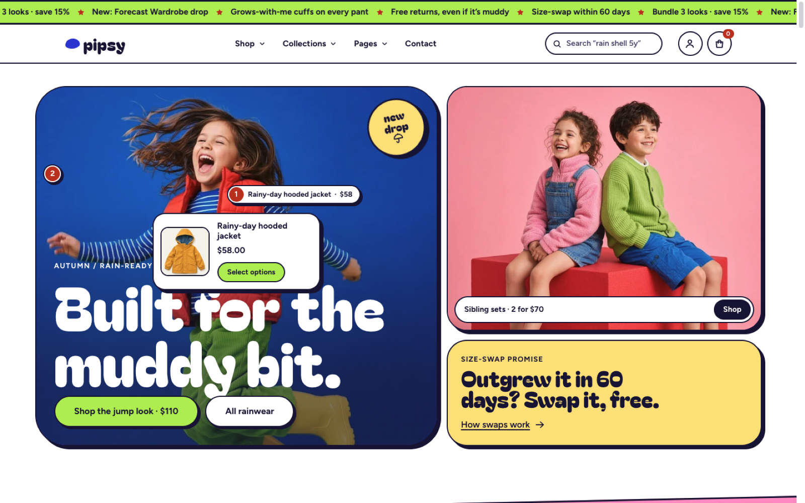
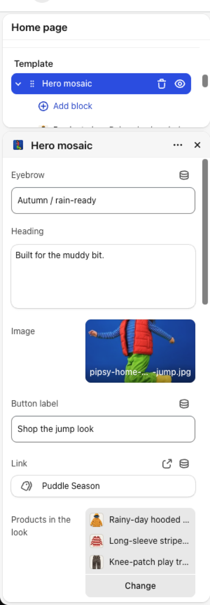

# Hero mosaic

A large poster with a photo, heading, two buttons, a round sticker and up to six product pins, next to two tiles (a photo tile and a text tile).

Clicking a pin opens a small product card with the price and a button:

## Section settings

| Setting | Default | What it does |
| --- | --- | --- |
| Eyebrow | "Autumn / rain-ready" | Small caps line above the heading. |
| Heading | "Built for the muddy bit." | Main heading (the page H1 only if the logo is not set as H1). |
| Image | | Poster photo. Set the focal point in the image picker to keep faces in view. |
| Button label / Link | "Shop the jump look" | First button (Lime). |
| Products in the look | | Their prices are added up and shown on the first button, for example "Shop the jump look · $110". |
| Second button label / Second button link | "All rainwear" | Outline button. |
| Sticker first line / second line | "new" / "drop" | Round sticker in the corner. Empty hides it. |
| Poster colour scheme | Scheme 8 (Cobalt) | Background behind the photo and text. |
| Section group | | Color scheme, width, padding, **Heading scale** (Small/Medium/Large), **Corner radius** (0–64 px). |

## Blocks

| Block | Settings |
| --- | --- |
| **Hero tile** (two fixed tiles) | **Tile style** (Photo tile or Text tile), Image, Eyebrow, Heading, Tag text, Heading link label, Link, Color scheme. Demo: a photo tile "Sibling sets · 2 for $70" and a text tile "Outgrew it in 60 days? Swap it, free." |
| **Product pin** (up to 6) | Product, Horizontal position (%), Vertical position (%), **Pin label** (a number or short mark; blank shows a plus icon). |


Place pins in the editor by changing the horizontal and vertical percentages while watching the preview. 0/0 is the top-left corner of the photo.

