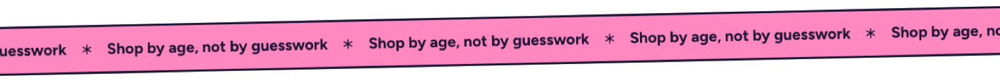

# Marquee

A band of scrolling text. In the demo it is a pink **tilted tape** under the hero.

| Setting | Default | What it does |
| --- | --- | --- |
| Text size | 40 px | 12–120 px. |
| Speed | 14 | 1–30. |
| Direction | Left | Left or Right. |
| Pause on hover | Off | |
| Show separators / Separator style | On / Dot | Dot, **Star in a colour disc** or Asterisk. |
| Separator colour scheme | Scheme 6 | The disc takes the scheme background and the star its text colour. |
| Band style | Plain | Plain, **Tilted tape** or Flat strip. |
| Band colour scheme | Scheme 5 (Bubble) | Colour of the tape or strip. |
| Section | | Color scheme, Section width, Top and Bottom padding. |

**Item** blocks (up to 12): **Text**, **Link**, **Icon**.

The section has three presets in **Add section**: *Tape marquee*, *Age tape* and *Marquee*.
