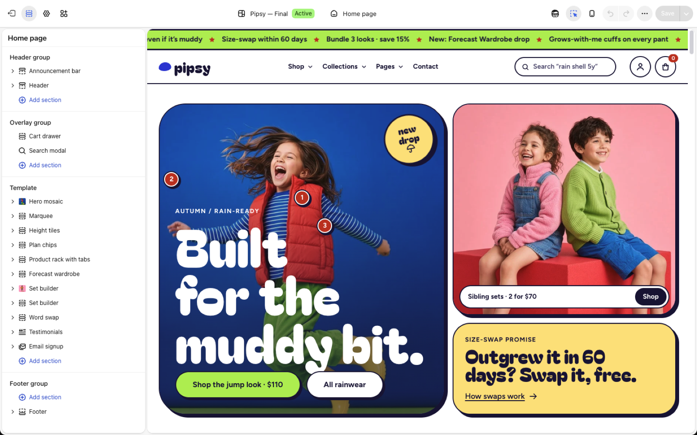

# Home page overview

The home page template (`templates/index.json`) is built from these sections, top to bottom. Open **Customize**; the home page is the default page in the editor.

| # | Section in the editor | What it shows in the demo | Page |
| --- | --- | --- | --- |
| 1 | Hero mosaic | Poster "Built for the muddy bit." with three product pins, a photo tile and a text tile | [Hero mosaic](hero-mosaic.md) |
| 2 | Marquee | Pink tilted tape "Shop by age, not by guesswork" | [Marquee](marquee.md) |
| 3 | Height tiles | "Who are we dressing today?" round age chips | [Height tiles](height-tiles.md) |
| 4 | Plan chips | "Pick the plan. We'll pick the fit." photo route cards | [Plan chips](plan-chips.md) |
| 5 | Product rack with tabs | "The Rack" with Just landed / Most re-bought / Under $30 tabs | [Product rack](product-rack.md) |
| 6 | Forecast wardrobe | "What's the sky doing?" weather tabs with three products each | [Forecast wardrobe](forecast-wardrobe.md) |
| 7 | Set builder | "One kid. Three pieces. One tap." outfit with a pinned photo | [Set builder](set-builder.md) |
| 8 | Set builder | "Top. Bottom. Something silly." three-step builder | [Set builder](set-builder.md#step-cards) |
| 9 | Word swap | "Made for the messy bits." Splash/Proof cards | [Word swap](word-swap.md) |
| 10 | Testimonials | "Real kids. Real knees." scroll collage | [Testimonials](testimonials.md) |
| 11 | Email signup | "Pipsy Post" card | [Email signup](email-signup.md) |

The header group, overlay group and footer group are shared by all pages.

## Settings shared by the home sections

Most Pipsy home sections end with a **Section** group with the same controls:

| Setting | What it does |
| --- | --- |
| Color scheme | Background and text colours of the band. |
| Section width | Boxed (content within the page width) or Full width. |
| Top / Bottom padding, Top / Bottom padding on mobile | Space inside the band. |
| Heading scale | Small, Medium or Large heading size for this section. |
| Corner radius | Roundness of the cards in the section. |

On the home page Pipsy keeps one spacing rhythm between bands: 120 px on desktop, about 106 px on tablets and 72 px on phones, whatever the individual padding values. The hero keeps its own spacing.


Links in the demo point to collections and pages with `shopify://` references. When a collection or page does not exist on your store, its button or tile link hides itself instead of leading to a 404 page. Re-pick the link in the editor. See [How links behave](../reference/links.md).


## Add, move or hide a section

* **Add section** under *Template* in the sidebar adds any Pipsy section.
* Drag the handle next to a section to move it.
* The eye icon hides a section without deleting its content.
