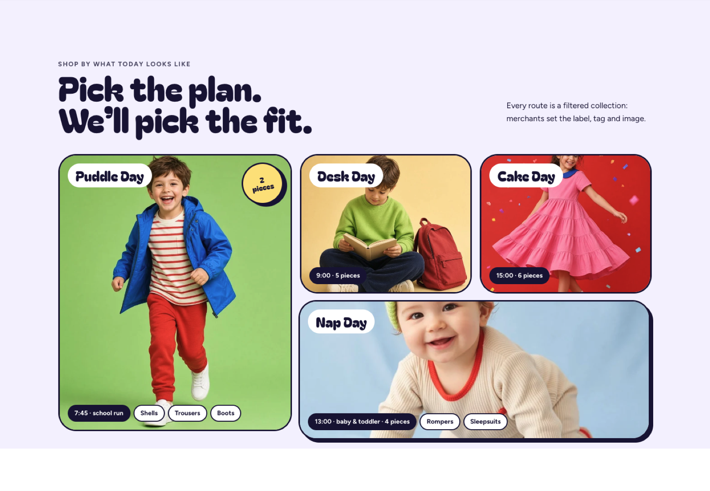

# Plan chips

"Shop by what today looks like": occasion routes that each link to a filtered collection. The demo uses **Photo route cards**; the catalog page reuses the same blocks as small chips.

## Section settings

| Setting | Default | What it does |
| --- | --- | --- |
| Eyebrow | "Shop by what today looks like" | |
| Heading | "Pick the plan. We'll pick the fit." | |
| Small note | | Short note on the right. |
| Presentation | Plan chips | **Plan chips** (pills with icons) or **Photo route cards**. |
| Section group | Scheme 3 | Color scheme, width, padding, heading scale, corner radius. |

## Plan chip blocks (up to 8)

| Setting | What it does |
| --- | --- |
| Icon | Umbrella, Pencil, Cake, Moon, Sun, Rain, Boot, Drop, Leaf, Heart, Star, Gift, Wash, Truck. |
| Chip label | For example "Puddle Day". |
| Small note | For example "7:45 · school run". |
| Image | Photo for the route card. |
| Collection | Sets the link when Link is empty and shows the piece count. |
| Small pills, separated by commas | For example "Shells, Trousers, Boots". |
| Link | Overrides the collection link. |
| Color scheme | Card colour. |
