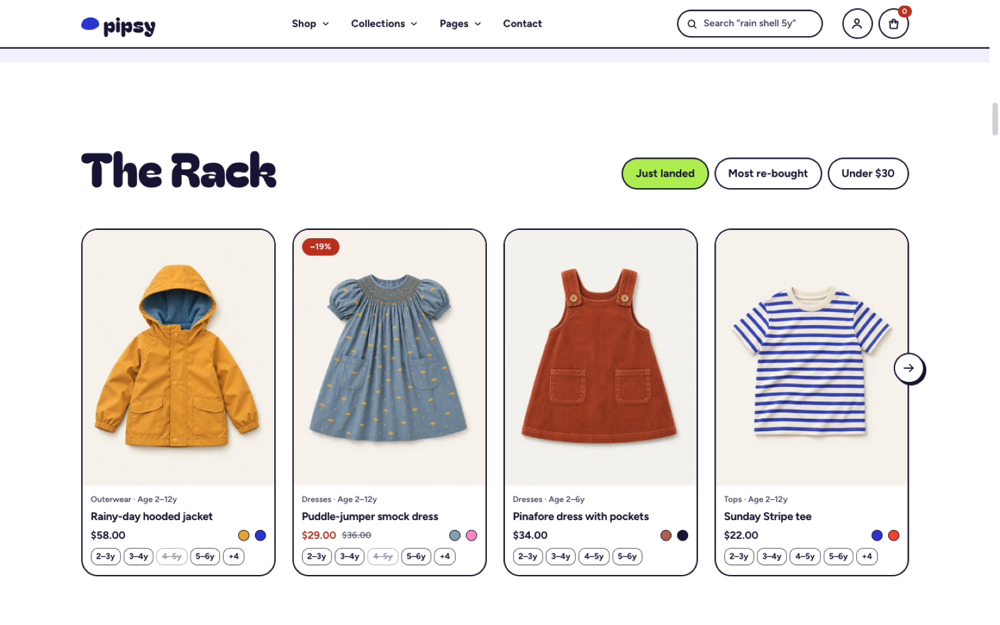

# Product rack with tabs

"The Rack": a product carousel with tab pills. Each tab shows a hand-picked product list or a collection.

## Section settings

**Eyebrow**, **Heading** (default "The Rack") and the Section group (color scheme, width, padding, heading scale, corner radius).

## Product tab blocks

| Setting | Default | What it does |
| --- | --- | --- |
| Title | "Just landed" | Tab label. |
| Products | | Hand-picked products. Used first when filled. |
| Collection | | Used when Products is empty. |
| Products to show | 6 | 2–12. |

Cards in the rack follow **Theme settings > Product tiles** (colour dots, size chips, quick view, add pill). See [Quick view, cards and colour swatches](../shopping/quick-view-and-cards.md).
