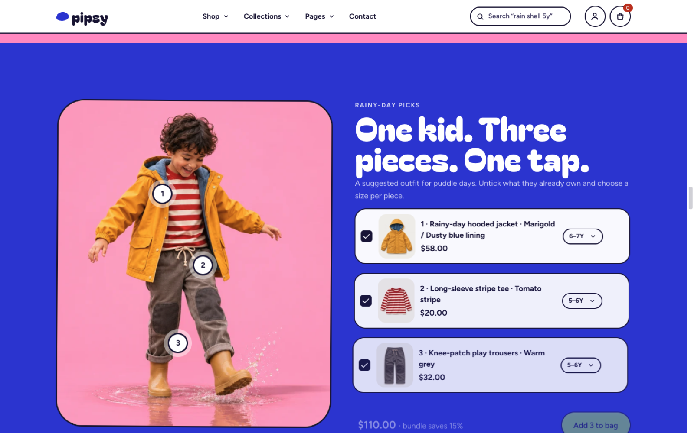
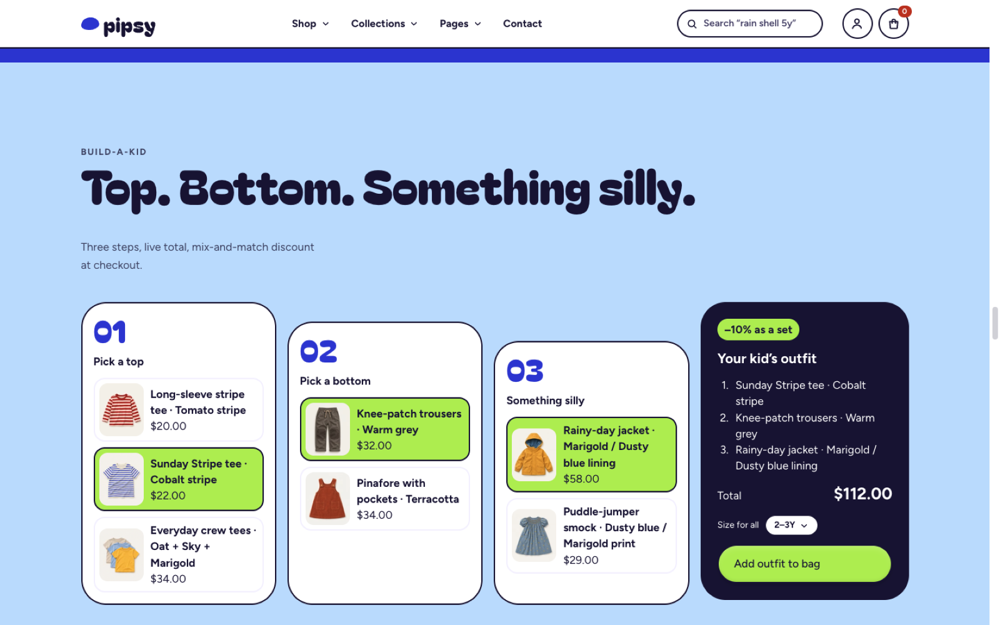
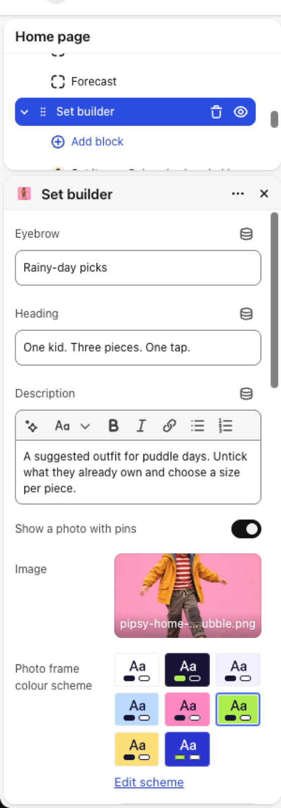

# Set builder

The set builder lets shoppers pick several pieces with a size each and add them to the bag in one tap. The demo uses it twice: as an outfit with a pinned photo, and as a three-step builder.

## Family rows with a photo

## Step cards

## Section settings

| Setting | Default | What it does |
| --- | --- | --- |
| Eyebrow, Heading, Description | "Build a set" | |
| Show a photo with pins | Off | Shows **Image** with **Product pin** blocks beside the list (demo: on for the first builder). |
| Image / Photo frame colour scheme | Scheme 6 | |
| Layout | Family rows | **Family rows** (a list with checkboxes), **Pick tiles** or **Step cards** (one card per group, a summary bar). |
| Size option name | "Size" | Case-insensitive option name. Other options keep the first available variant. |
| Size picker | Chips | Chips or Dropdown. |
| Let shoppers untick pieces | On | |
| Pieces to pick | 3 | 2–6, for step cards. |
| Saving shown (%) | 0 | **Display only.** Create the matching automatic discount in Shopify admin; the theme never changes prices. |
| Saving line | "Save {discount}% as a set" | `{discount}` is replaced by the percentage. |
| Button label | "Add {count} to bag" | `{count}` is the number of pieces. |
| Summary bar colour scheme / Summary title | Scheme 1 | |
| Remaining steps hint | | `{left}` steps left, `{discount}` percentage. Demo: "{left} step(s) to go · {discount}% off the full set". |
| Section group | Scheme 4 | |


The set builder shows a saving but does not apply it. Create an automatic discount (for example "Buy 3, get 10% off" on the products of the set) in **Discounts** so the price at checkout matches the promise.


## Blocks

| Block | Settings |
| --- | --- |
| **Set item** | Product, Display name (blank = product title), Pre-selected size, **Group label** (for step cards, for example "Pick a top"), Selected by default. |
| **Product pin** | Product, Horizontal and Vertical position, Pin label. Pins highlight their row when hovered. |

If none of the chosen products is available, the section hides itself.
