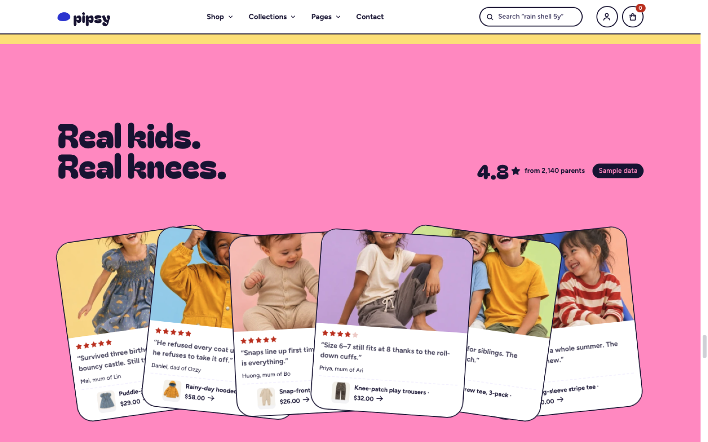

# Testimonials

"Real kids. Real knees.": parent quotes with the child's age, height, fit and the product they bought. The demo uses the **Scroll collage** layout with a summary score.

## Section settings

| Setting | Default (demo) | What it does |
| --- | --- | --- |
| Show summary bar / Summary score / Summary label | Off (demo: on, "4.8", "from 2,140 parents") | Score next to the heading. |
| Show fit bar / Fit position | On (demo: off), 50% | A small-to-big fit scale: 0 runs small, 50 true to size, 100 runs big. |
| **Sample data label** | Demo: "Sample data" | Keep it on demo stores. **Clear it only when the quotes are real.** |
| Layout | Grid (demo: Scroll collage) | Grid, Slider, Editorial carousel or Scroll collage. |
| Trust pills, separated by commas | Demo: "60-day size swap, Organic & recycled, Free over $60, 40° wash-tested" | |
| Number of columns on desktop / mobile, Gap spacing, Card background | 3 / 1, 30 px | For grid and slider. |
| Editorial carousel > Show pagination, Auto-rotate, Change testimonial every | | |
| Heading group | "Real kids. Real knees." | Heading, size, weight, alignment, tag, subheading, description, button. |
| Color scheme, padding | Demo: Scheme 5 | |
| Enable motion | On | Scroll movement of the collage. |

## Testimonial blocks (up to 12)

**Icon** (None, Quote, 5 to 1 stars), **Heading**, **Text**, **Author**, **Author info** (for example "mum of Lin"), **Child age**, **Child height**, **Fit tag** (Runs small, True to size, Runs big), **Author URL**, **Product** (shown as a small product link), **Author's image**, **Image ratio**, **Image height**.


The demo quotes are sample content. Replace them with real customer feedback, or keep the Sample data label visible.

