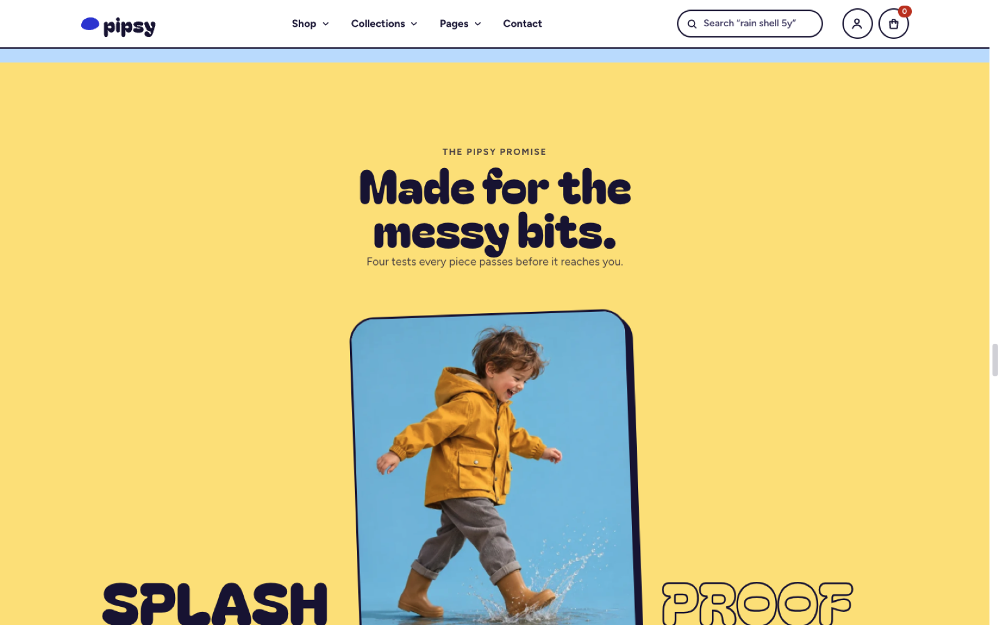

# Word swap

"Made for the messy bits.": a stack of tilted photo cards. As the shopper scrolls, each card swaps the two big words on either side (Splash / Proof, …) and shows a short promise with a button.

## Section settings

| Setting | Default | What it does |
| --- | --- | --- |
| Eyebrow | "The Pipsy promise" | |
| Heading | "Made for the messy bits." | A line break in the field starts a new line. |
| Description | "Four tests every piece passes before it reaches you." | |
| Tilt cards | On | Rotates the cards slightly. |
| Section group | Scheme 7 | |

## Word swap slide blocks (up to 8)

**Image**, **Left word**, **Right word**, **Text**, **Button label**, **Link**, **Color scheme**.
