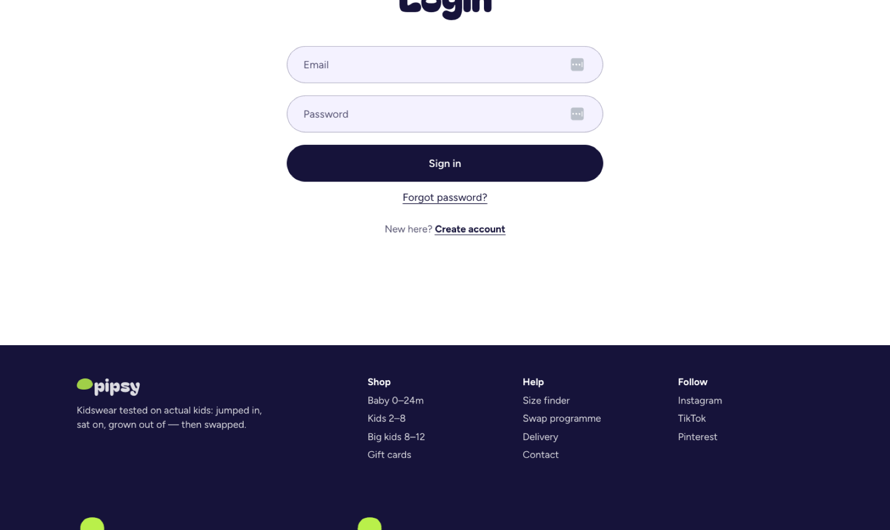

# Customer accounts

Shopify offers two kinds of customer accounts (**Settings > Customer accounts**):

* **Customer accounts** (the current, default kind) are pages hosted by Shopify. They use your logo and colours from the Shopify admin branding settings, not theme templates. This is what the Pipsy demo store uses.
* **Legacy customer accounts** use the theme's templates. Pipsy styles all of them: login, register, account dashboard, order, addresses, activate account and reset password (`templates/customers/*.json`).


This screenshot was taken on an earlier preview of Pipsy with legacy accounts turned on, so its header menu differs from the current demo.


## Settings

* The account button in the header: **Header > Show account icon**.
* The menu inside the account area: **Theme settings > Customer accounts > Customer account menu**.
* The [Order tracking](../content-pages/order-tracking.md) page sends signed-in customers to their latest order and everyone else to the account login, which works with both kinds of accounts.
