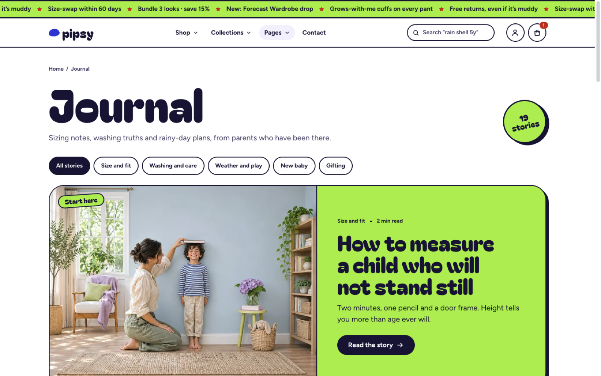
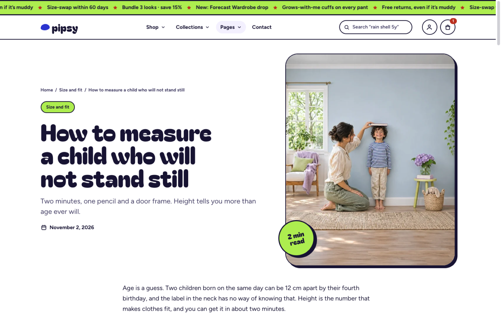

# Journal (blog)

The blog listing (`templates/blog.json`) has **Blog posts** and an **Email signup** section. The article page (`templates/article.json`) has the **Blog post** section with its blocks. The demo blog is called Journal (handle `journal`) and is linked from **Pages > Journal** in the main menu.

## Blog posts section

| Group | Settings |
| --- | --- |
| Heading | Heading (blank = blog title), Description, Show breadcrumb, Show story count sticker. |
| Topics | **Show tag filter** (topic chips), Label of the first chip ("All"). |
| Lead story | Show lead story (first page only, left out of the grid), **Featured article** (blank = newest), Featured label, Button label, Lead story color scheme. |
| Blog post card | Heading above the stories, Posts per page (3–24), Number of columns (2–4), Image ratio, Show tags, Show excerpt, Show date, Show reading time, **Reading speed** (words per minute for the reading time). |
| Color | Color scheme, **Accent** (Lime, Butter, Bubble or Sky) for stickers, topic pills and tip panels. |
| Section | Desktop and mobile padding. |

**Topic** blocks choose which tags appear as chips, and their order: **Tag** (exactly as on the articles; the chip hides when no article has it), **Label**, **Introduction** (shown under the title while the topic is open). Without Topic blocks, every tag of the blog is listed.

## Article page

**Blog post** section: Show breadcrumb, tags, introduction (excerpt), date, author, reading time and reading speed; **Featured image** (show, image ratio, **Photo tilt** −4° to 4°); Color scheme, Accent, **Quote panel color scheme**; padding.

| Block | Settings |
| --- | --- |
| **Share and links** | Show share links (networks from Theme settings > Social media), Share label, Show copy link button, Show link back to the blog. |
| **Comments** | Comments per page. Comments appear when they are turned on for the blog in the admin. |
| **Further stories** | Heading ("Keep reading"), Link label, Stories to show, Reading speed, color scheme, padding. |
| **Product row** | Heading, Collection, Products (blank = first products of the collection), Products to show, Link label, Link, color scheme, padding. |


**Quote and tip panels.** In the article editor, a quote (`blockquote`) is shown as a coloured quote panel. A tip panel is any `aside` element, or an element with the class `journal-tip`, added with the editor's HTML view (`<>` button).

