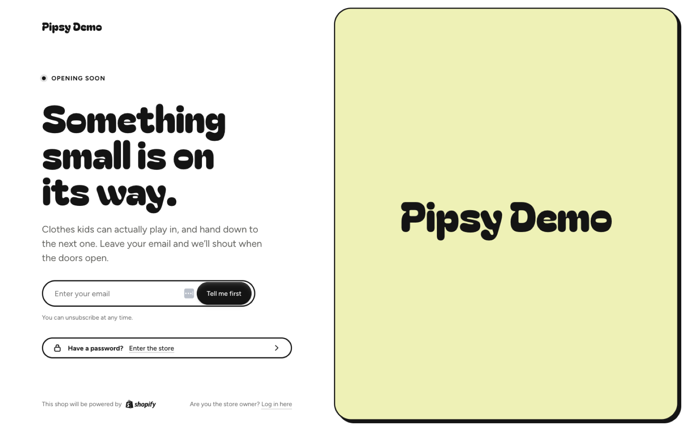
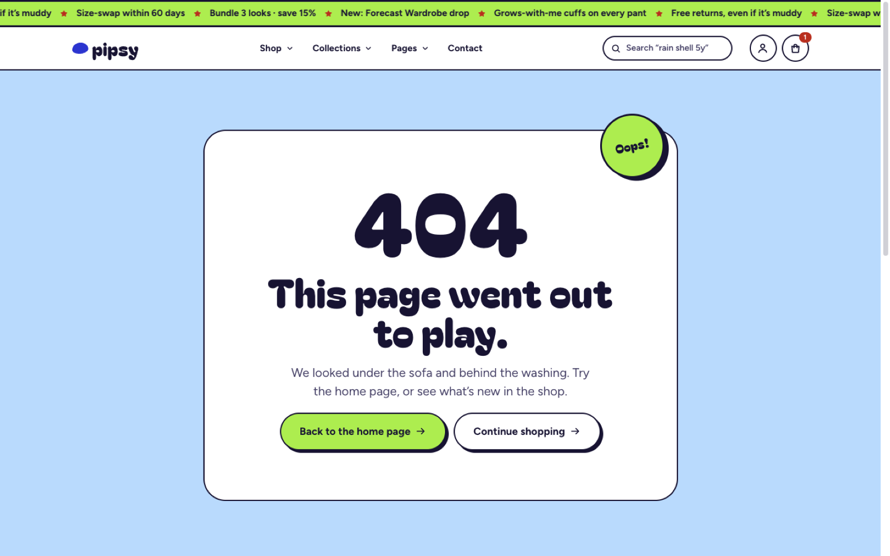

# Password page and 404

## Password page

Shown while the store is password protected (**Online Store > Preferences > Password protection**). Template `password.json`, section **Launch signup**.

| Setting | Default | What it does |
| --- | --- | --- |
| Section width | Full width | |
| Subheading, Heading, Text | "Opening soon", "Our store is almost ready", … | |
| Show email signup / Button label / Text below form | On, "Notify me", "You can unsubscribe at any time." | Collects emails for your launch. |
| Show password entry | On | Opens the password window. Off shows a password button in the header instead. |
| Image, Image position on desktop, Hide on mobile | Right | Photo panel. Without an image the panel shows the shop name. |
| Panel color scheme, Color scheme | Scheme 2, Scheme 1 | |
| Top / Bottom padding | | |

Open it in the editor with the template menu at the top: **Password**.


This screenshot was taken on an earlier preview of Pipsy, without an image in the panel.


## 404 page

Shown for any address that does not exist. Template `404.json`, section **404 page**.

| Setting | Default |
| --- | --- |
| Section width | Boxed |
| Color scheme | Scheme 4 |
| Card / Sticker / Button / Second button color scheme | Scheme 1 / 6 / 6 / 1 |
| Card corner radius | 36 px |
| Heading scale | 100% |
| Top / Bottom padding, Mobile top / bottom padding, Make section narrow | |

The texts of the 404 page are storefront texts; change them in **Edit default theme content** (see [Translations](../reference/translations.md)).
