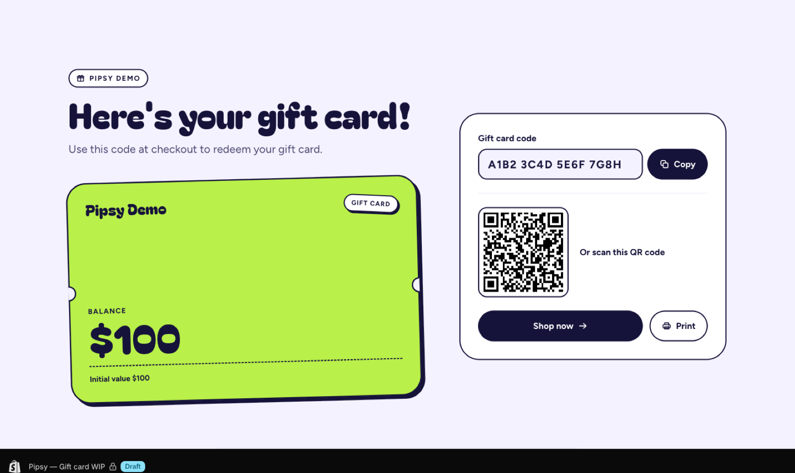

# Gift cards

Pipsy has two gift card templates.

## Gift card product

`templates/product.gift-card.json` uses the same product layout as other products, without the size and promise blocks: title, price, short description, variant picker (denominations, size not required, colour swatches off), buy buttons with the **Gift card recipient** form on, and the description. Below it are three gift card questions in **Good to know** and related products.

To use it:

1. Create a gift card product in **Products > Gift cards > Add gift card product** (or a product of type gift card).
2. In the product's **Theme template** (Online Store section, right column), choose **gift-card**.
3. Save.

With **Gift card recipient** on (Product buy buttons block), shoppers can send the card to someone else with a name, message and send date.

## Gift card page

`templates/gift_card.liquid` is the page the customer opens from the gift card email. It shows a Lime card with the balance, the code with a **Copy** button, a QR code, an Apple Wallet badge when available, **Shop now** and **Print**. Expired or disabled cards are shown greyed out with a notice. It has no editor settings; it uses your logo (or shop name) and color schemes.


This screenshot was taken on an earlier preview of Pipsy with a test card; the code shown is a sample.

