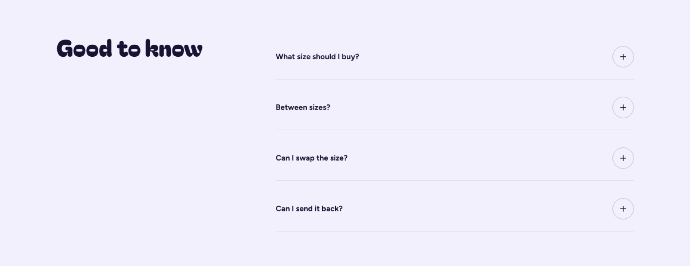
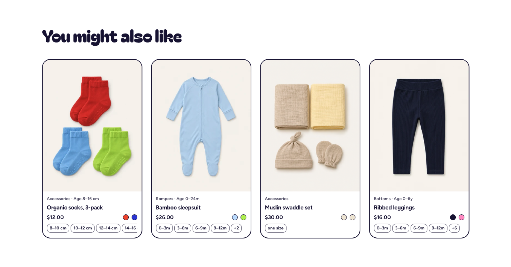

# Good to know and related products

## Help accordion ("Good to know")

The **Help accordion** section shows short questions and answers. It is the same section on every product (the answers are not per product).

| Setting | Default | What it does |
| --- | --- | --- |
| Heading | "Good to know." | |
| Introduction | | Text under the heading. |
| Contact link label / Contact link | | An optional link under the introduction. |
| Open only one question at a time | On | |
| Color scheme | Scheme 1 (demo: Mist) | |
| Open question color scheme | Scheme 4 | Background of the opened question. |
| Section width, Show top divider | Boxed, Off | |
| Anchor ID | | Lets links such as `#good-to-know` jump here. Use a unique ID on each page. |
| Top / Bottom padding, Enable motion | | |

**Question** blocks (up to 6): **Question**, **Answer**, **Answer link label**, **Answer link**. The demo asks "What size should I buy?", "Between sizes?", "Can I swap the size?" and "Can I send it back?".

## Related products

Shopify's product recommendations, shown as Pipsy cards. The section disappears entirely when there is nothing to recommend.

| Setting | Default | What it does |
| --- | --- | --- |
| Number of related products | 6 | 2–12. |
| Number of columns on desktop | 4 | 1–5. |
| Product card gap | 6 px | |
| Enable carousel on desktop | On | |
| Mobile layout > columns, Enable swipe on mobile | 1, On | |
| Heading | "You may also like" (demo: "You might also like") | Plus size, weight, alignment, tag, subheading, description. |
| Color scheme, padding, width | | |


To choose related products yourself, use Shopify's **Search & Discovery** app > Recommendations.

