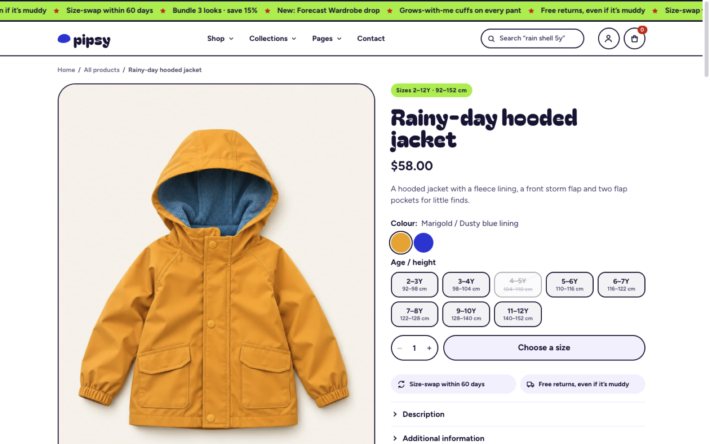
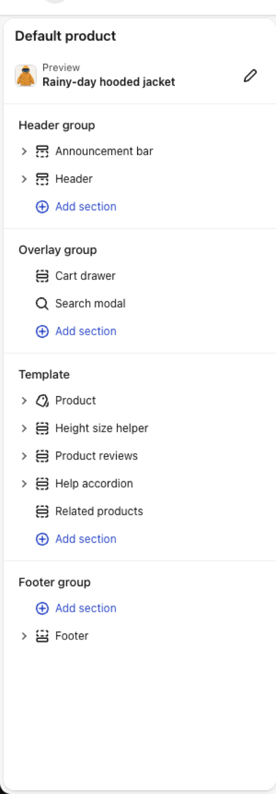
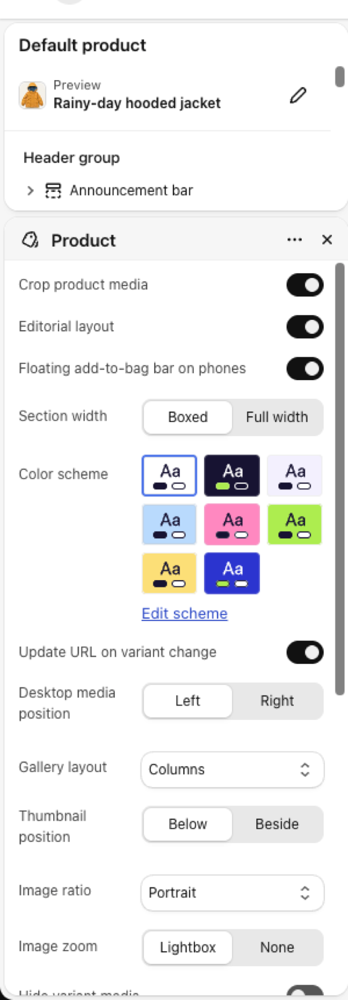
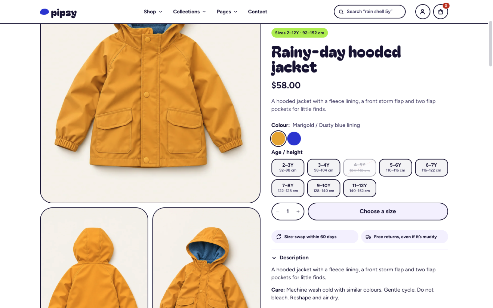
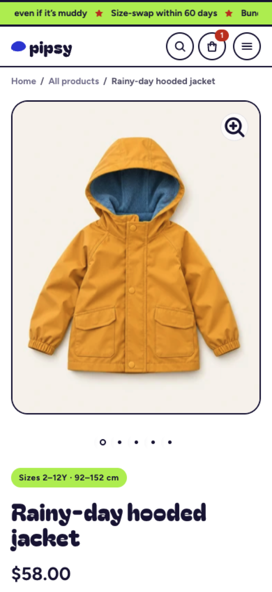
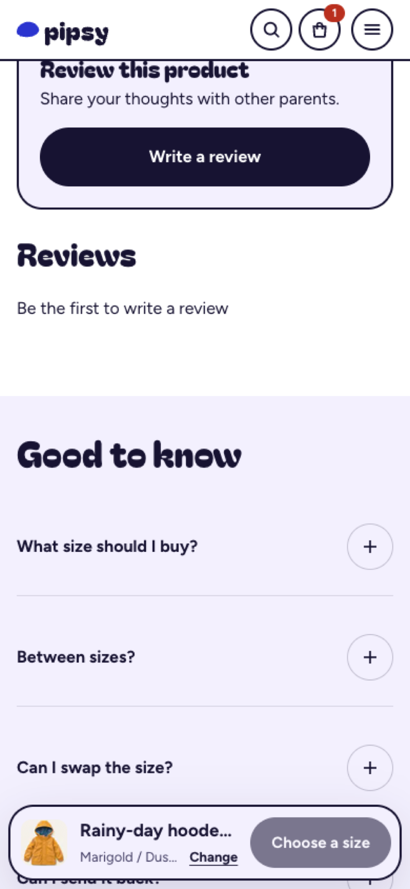

# Product page

The product template (`templates/product.json`) has five sections:

| # | Section | What it shows |
| --- | --- | --- |
| 1 | **Product** | Gallery and buy box |
| 2 | **Height size helper** | "Measure their height, not their age." band — see [Size data](size-data.md) |
| 3 | **Product reviews** | Reviews band — see [Product reviews](reviews.md) |
| 4 | **Help accordion** | "Good to know" questions — see [Good to know and related](good-to-know-and-related.md) |
| 5 | **Related products** | "You might also like" — see [Good to know and related](good-to-know-and-related.md) |

## Product section settings

| Setting | Default (demo) | What it does |
| --- | --- | --- |
| Crop product media | Off (demo: on) | Crops photos to the image ratio. |
| Editorial layout | Off (demo: on) | Large gallery with a sticky buy box. |
| Floating add-to-bag bar on phones | On | A bar with the product, variant and add button appears on phones after scrolling past the buy buttons. |
| Section width | Boxed | |
| Color scheme | Scheme 1 | |
| Update URL on variant change | On | |
| Desktop media position | Left | Left or Right. |
| Gallery layout | Thumbnails (demo: Columns) | Thumbnails, Scroll, Columns or Fit study. |
| Thumbnail position | Below | Below or Beside. |
| Image ratio | Adapt to first image (demo: Portrait) | |
| Image zoom | Lightbox | Lightbox or None. |
| Hide variant media | Off | Shows only the selected variant's images. |
| Autoplay video / Loop video | Off | |
| Mobile layout, Mobile image ratio, Mobile thumbnails | Full width | |
| Top / Bottom padding | | |

## Blocks in the buy box

| Block | Settings | What it shows |
| --- | --- | --- |
| **Size range badge** | — | Lime pill "Sizes 2–12Y · 92–152 cm", from the first and last size and their heights. Hidden when the product has no age size range. |
| **Product title** | Show rating | The title; with **Show rating** on, a star score linking to the reviews band (only when the product has ratings). |
| **Product price** | — | Price, compare-at price and sale colour. |
| **Short description** | Word limit (10–80), Text | First words of the description, or your own text. |
| **Product variant picker** | Dynamic variants, Show labels, Picker type (Buttons or Dropdown), Color swatches, Swatch type, Size chart (a page), Low stock threshold, Show fit note, Require a size choice, Size option label | Colour swatches and size buttons. Age sizes show the child's height under the label. |
| **Product buy buttons** | Show quantity, Show price, Show Buy it now, Gift card recipient, Back in stock (Collect name, Collect phone) | Quantity, "Add to bag · $58.00", express checkout, back-in-stock form for sold-out variants. |
| **Product meta** | Item 1, Item 2, Item 3 | Promise pills under the buttons (demo: "Size-swap within 60 days", "Free returns, even if it's muddy"). |
| **Product description** | Heading | Collapsible full description (demo heading: "Description"). |
| **Product facts** | Heading, Show product type | Collapsible "Additional information" table. |
| **Product pickup** | — | Local pickup availability when enabled. |

Other blocks you can add: **Product badges**, **Share buttons** (networks from Theme settings > Social media), **Size chart** (see [Size data](size-data.md#size-chart-block)), product collapsible rows, inventory, and app blocks. The general blocks (heading, text, button, image, icon, group, accordion, video and more) can also go in the buy box.


Product blocks are listed under **Add block** only in product sections (the product page, Featured product and quick view). Containers elsewhere, such as Image banner, Popup, Group, tabs and accordion rows, list only the general blocks.


## On phones

