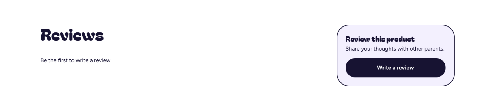
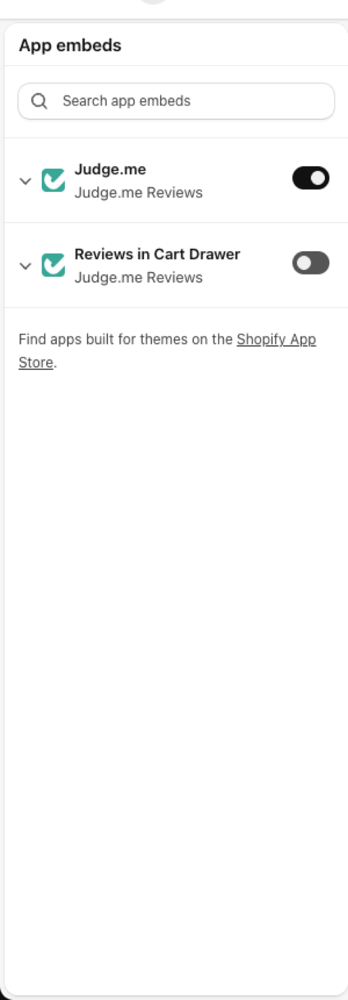
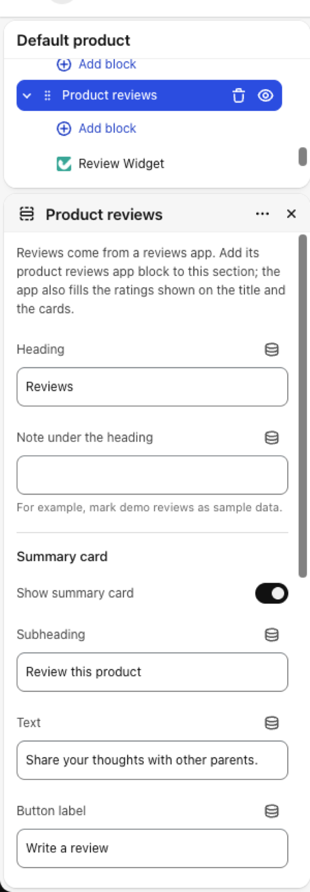

# Product reviews (Judge.me)

Pipsy does not store reviews itself. A reviews app does: it draws the review list and form through an **app block**, and writes the standard Shopify metafields `reviews.rating` and `reviews.rating_count`, which Pipsy reads for the summary card, the stars by the product title and the stars on product cards. The theme is set up and tested with **Judge.me** (free plan); other apps that provide a product reviews app block and those metafields work the same way.

## 1. Install Judge.me

1. Open the [Shopify App Store](https://apps.shopify.com) and install **Judge.me Product Reviews**. Choose the free plan.
2. Follow the app's setup. You do not need to add any code to the theme.

## 2. Turn on the app embed

1. Open **Customize**.
2. Click the **App embeds** icon in the left bar.
3. Turn on **Judge.me** and click **Save**.

## 3. Add the review widget to the Reviews band

1. In the editor, open a product page (top menu **Products > Default product**).
2. Select the **Product reviews** section.
3. Click **Add block** under it and choose the Judge.me **Review Widget** app block. (On the Pipsy demo it is already in place.)
4. Save.

## Section settings

| Setting | Default | What it does |
| --- | --- | --- |
| Heading | "Reviews" | |
| Note under the heading | | For example, mark imported demo reviews as sample data. |
| Show summary card | On | The card with the average score and the write button. |
| Subheading | "Review this product" | |
| Text | "Share your thoughts with other parents." | |
| Button label | "Write a review" | |
| Review form trigger | `[data-testid="write-review-button"], .jdgm-write-rev-link` | CSS selector of the app's own write button. The card button clicks it, so the app's form opens. For another app, enter its button selector; if nothing matches, the card button scrolls to the app block. |
| Color scheme, padding | | |

## What shoppers see

* **No app block and no ratings:** the band is hidden on the storefront. In the editor it shows a note asking you to add the app block.
* **App block, no reviews yet:** the heading, the app's "Be the first to write a review" line and the summary card with **Write a review**.
* **With reviews:** the summary card shows the average score and stars; the app's own header score and button are hidden so the score appears once. The app's filter and sort buttons stay.
* **Stars elsewhere:** turn on **Show rating** in the **Product title** block, and **Theme settings > Product tiles > Show product rating** for cards. Products without reviews show no stars.


**Preview score in the editor.** In the theme editor only, a product without ratings shows an illustrative "4.6 / 5 from 128 reviews" in the summary card, labelled *Preview: sample score, shown only in the theme editor*. It lets you design the card before reviews exist. The storefront never shows it.



Only import reviews that are genuine. Review apps ask you to confirm this when importing a spreadsheet.


The stars and buttons inside the widget follow your theme: the star colour is the **Reviews** colour of the color scheme, buttons use Ink pills, and the write form opens in a Pipsy-styled frame.
