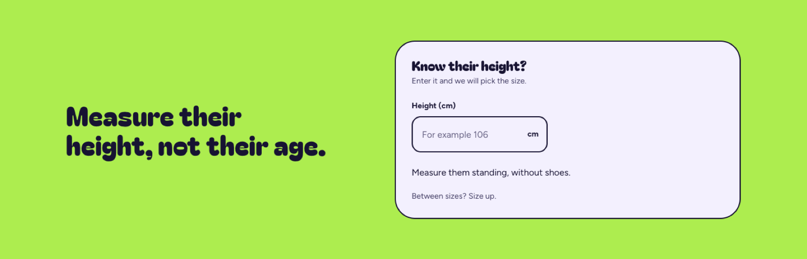
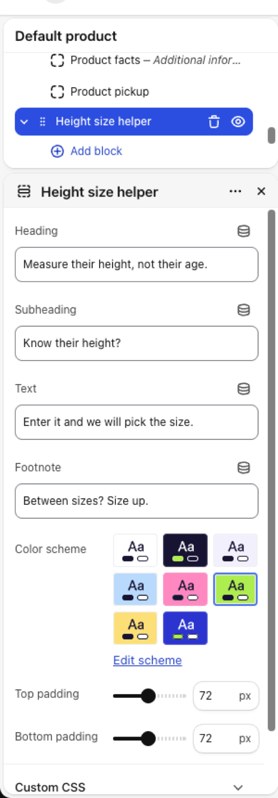

# Size data and the height helper

Pipsy turns size labels into child heights. It reads them from **metaobjects** in your store, and falls back to a built-in table while you have none.

## How sizes are read

* The theme looks for the product option named **Size** (or the translated word for size in your storefront language).
* Age sizes are written with an en dash: `0–3M`, `3–6M`, `2–3Y`, `11–12Y`.
* Each size is looked up in the `size_range` metaobjects by its **Label**. The match gives the height range shown under the size button ("92–98 cm"), in the size range badge and in the height helper.

## Built-in fallback table

Until your store has `size_range` entries, Pipsy uses this table:

| Size | Height (cm) | | Size | Height (cm) |
| --- | --- | --- | --- | --- |
| 0–3M | 50–62 | | 4–5Y | 104–110 |
| 3–6M | 62–68 | | 5–6Y | 110–116 |
| 6–9M | 68–74 | | 6–7Y | 116–122 |
| 9–12M | 74–80 | | 7–8Y | 122–128 |
| 12–18M | 80–86 | | 9–10Y | 128–140 |
| 18–24M | 86–92 | | 11–12Y | 140–152 |
| 2–3Y | 92–98 | | | |
| 3–4Y | 98–104 | | | |


The fallback is a general guide, not your brand's measurements. Add your own `size_range` entries before launch.


## Create the size metaobjects

In Shopify admin, go to **Settings > Custom data > Metaobjects > Add definition**. Turn on **Storefront access** for each definition, or the theme cannot read it.

**`size_range`** (one entry per size)

| Field key | Type | Example |
| --- | --- | --- |
| `label` | Single line text | `2–3Y` (must match the option value exactly) |
| `cm_from` | Integer | `92` |
| `cm_to` | Integer | `98` |
| `stage` | Single line text | `toddler` |
| `stage_label` | Single line text (optional) | `Toddler` |
| `age_band` | Single line text | `toddler` |
| `sort` | Integer | `7` |

**`size_chart`** (one entry per chart, for example `baby`, `toddler`, `kids`)

| Field key | Type | Notes |
| --- | --- | --- |
| `title` | Single line text | |
| `unit` | Single line text | `cm` or `in` |
| `sizes` | List of single line text | Column headings, for example `0–3M`, `3–6M` |
| `body_bust`, `body_waist`, `body_hips`, `body_inside_leg` | List of decimals | Optional rows |
| `measurements`, `garment` | JSON | Optional row sets |
| `fit_scale` | Integer | Optional |
| `fit_note` | Multi-line text | Optional |

Link a chart to a product with the product metafield `pipsy.size_chart` (a metaobject reference to `size_chart`). The namespace follows **Theme settings > Size data > Metafield namespace**.

## Height size helper section

The shopper types the child's height; the matching size is selected in the product's size picker. The section renders nothing for products without a known size option.

| Setting | Default |
| --- | --- |
| Heading | "Measure their height, not their age." |
| Subheading | "Know their height?" |
| Text | "Enter it and we will pick the size." |
| Footnote | "Between sizes? Size up." |
| Color scheme | Scheme 6 (Lime) |
| Top / Bottom padding | 72 px |

## Size chart block

The **Size chart** block (in the product buy box or in the [Size guide page](../content-pages/size-guide.md)) shows the product's `size_chart` metaobject. On pages without a product it uses the **Metaobject handle** you type.

| Setting | What it does |
| --- | --- |
| Layout style | Inline, Drawer, Modal or On the page. |
| Metaobject handle | For example `baby`, `toddler` or `kids`. |
| Trigger button label | "Size chart" |
| Show garment measurements tab / Show measuring guide tab | |
| Measuring guide content | Rich text for the guide tab. |

It renders nothing when no chart is found.
