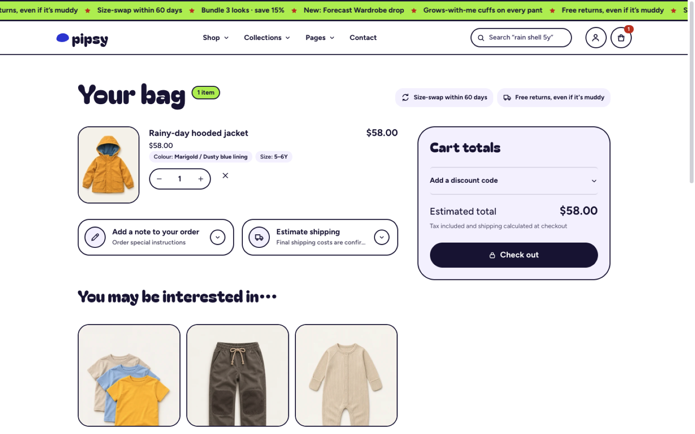
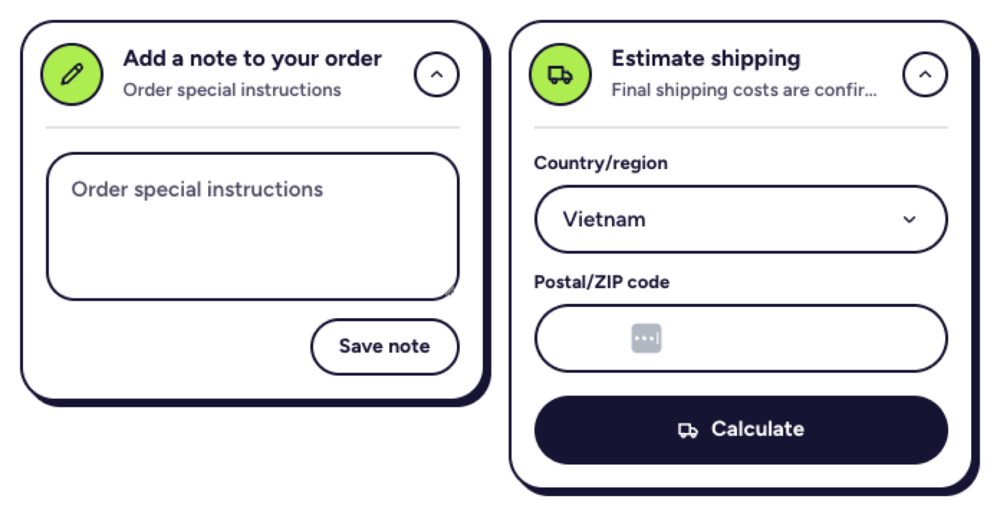

# Cart page

The cart page (`/cart`, section **Cart page**) shows the lines, two tool cards (order note and shipping estimate), the order summary and suggestions. The [cart drawer](../header-footer/drawers-and-popup.md#cart-drawer) is set up separately.

The note and shipping cards open in place. The shipping card lists the countries you ship to and shows the rates:

## Section settings

| Setting | Default | What it does |
| --- | --- | --- |
| Editorial cart layout | Off | Alternative layout. |
| Heading | "Your bag" | |
| Promise pills | Swap "Size-swap within 60 days", Truck "Free returns, even if it's muddy" | Two icon pills by the heading. |
| Show vendor | Off | |
| Order summary > Heading | | |
| Show payment icons | On | |
| Show shipping rates calculator | On | The Estimate shipping card. |
| Allow discounts in cart | On | Discount code field in the summary. |
| Order note position | In order summary | Or below the cart items. Applies with a **Cart note** block. |
| Suggestions > Heading, Products, Products to show | "You may be interested in…", 3 | Products already in the cart are left out. |
| Empty cart > heading, text, button label | "Your bag is empty.", "The puddles can wait.", "Browse store" | |
| Empty cart > products heading, collection, products to show | "New in store", 4 | |
| Section | | Padding and width. |

## Blocks

**Subtotal**, **Cart note**, **Checkout button**, **Free shipping message**, **Custom field** (an extra cart attribute) and app blocks.


To skip the drawer and always use this page, set **Theme settings > Cart > Cart type** to **Page**.

