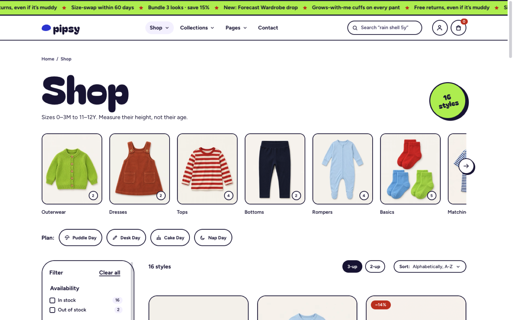
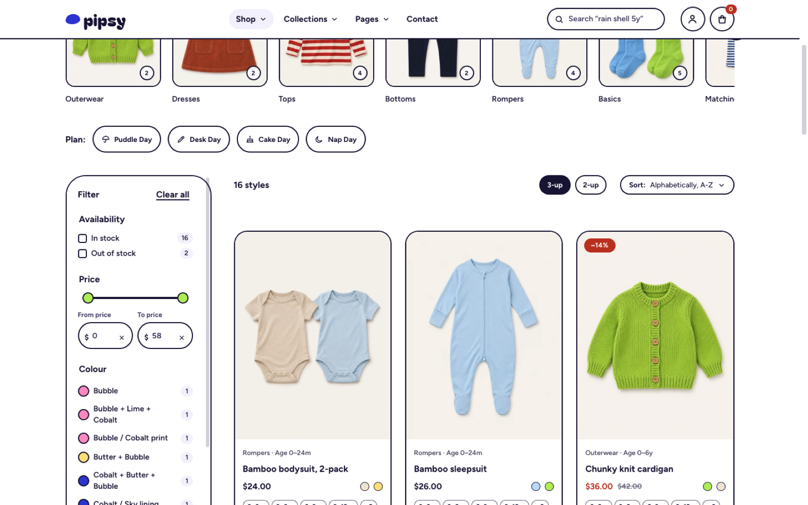
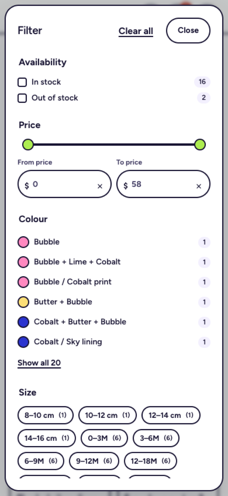

# Collection page

The collection template (`templates/collection.json`) has two visible sections: **Catalog intro** (title, count sticker, collection carousel and plan chips) and **Product grid** (filters, sorting, view toggle and cards). A third section, **Collection banner**, is included but hidden; turn it on if you prefer a full-width image banner.

## Catalog intro

| Setting | Default (demo) | What it does |
| --- | --- | --- |
| Subheading | | Small line above the title. |
| Heading | "Shop" | Title of the all-products page and its breadcrumb name. Collections use their own title. |
| Description | Demo: "Sizes 0–3M to 11–12Y. Measure their height, not their age." | Shown when the collection has no description of its own. |
| Show product count sticker | On | Round "16 styles" sticker. |
| Show a search field on the search page | On | The same section is used on the search page. |
| Collection list | Demo: Outerwear, Dresses, Tops, Bottoms, Rompers, Basics, Matching family | Carousel of collection cards with counts. |
| Chip row label | "Plan:" | Label before the **Plan chip** blocks. |
| Color scheme, Background, Image, Overlay opacity | | Optional coloured or photo background. |
| Section | | Padding, width, **Allow transparent header** (when this is the first section). |

**Plan chip** blocks work as on the home page: icon, label, collection or link. See [Plan chips](../home-page/plan-chips.md).

## Product grid

| Setting | Default (demo) | What it does |
| --- | --- | --- |
| Show product cards with dimensions | Off (demo: on) | Turns on the Pipsy catalog view: the 3-up / 2-up view toggle and the framed Pipsy cards. |
| Products per page | 16 (demo: 12) | 6–50. |
| Number of columns on desktop / mobile | 3 / 2 | |
| Product card gap | 6 px (demo: 24) | |
| Pagination | Regular pagination (demo: Click to load) | Infinite, Click to load or Regular pagination. |
| Enable filtering | On | Filters come from the Shopify **Search & Discovery** app. |
| Show product tag filter | Off | Turn on only when tags are written for customers. |
| Filter layout | Vertical (sidebar) | Drawer or Vertical. Phones always use the drawer. |
| Collapse filters | Off | Starts with filter groups closed. |
| Enable color swatches | Demo: on | Colour filter values as swatches. |
| Enable sorting | On | |
| Show on model | Off | |
| Buttons style | Secondary | |
| Color scheme, padding, width | | |

**Blocks**: Collection description, Subcollections, **Promotion image** and **Promotion video** (cards placed inside the grid).

## Filters

1. Install **Search & Discovery** (free, by Shopify).
2. In the app, open **Filters** and add the filters you want, for example Availability, Price, product option **Colour** and product option **Size**.
3. Their order in the app is their order in the sidebar.

