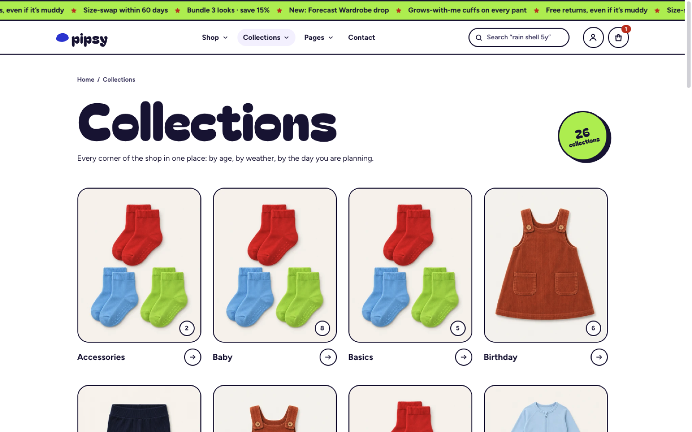

# Collections list

The page at `/collections` (template `list-collections.json`, section **Collections list page**).

| Setting | Default | What it does |
| --- | --- | --- |
| Select collections to show | All | All, or **Selected** with Collection blocks. |
| Sort collections by | Alphabetically, A–Z | Also by date or product count. |
| Image | Collection image | Or the first product's image. |
| Image ratio | Portrait | |
| Show total number of products | On | |
| Number of columns on desktop / mobile | 4 / 2 | |
| Heading / Description / Show collection count | "Collections" | |
| Color scheme, padding, width | | |
