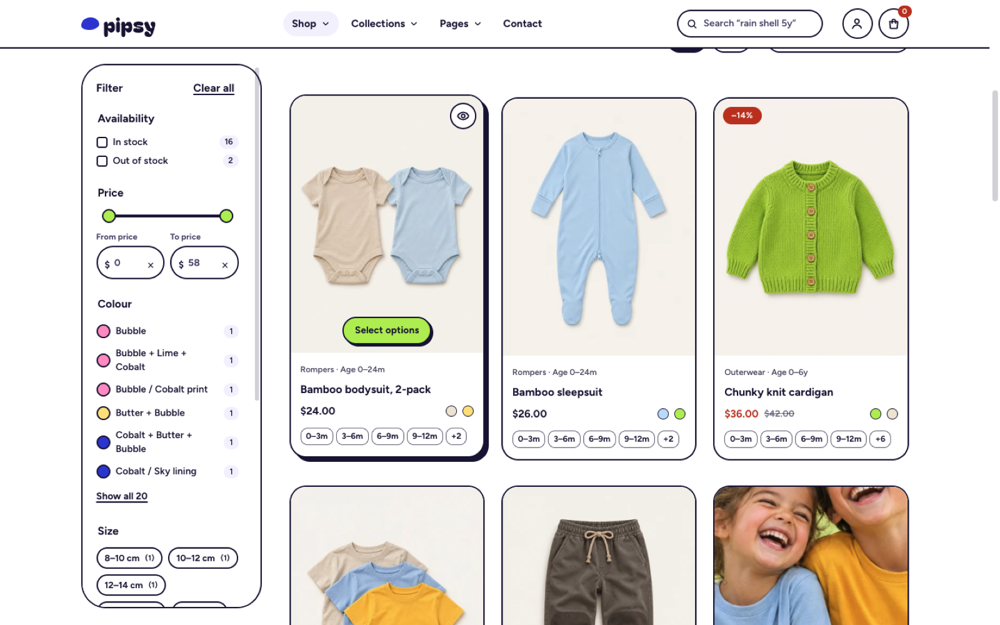
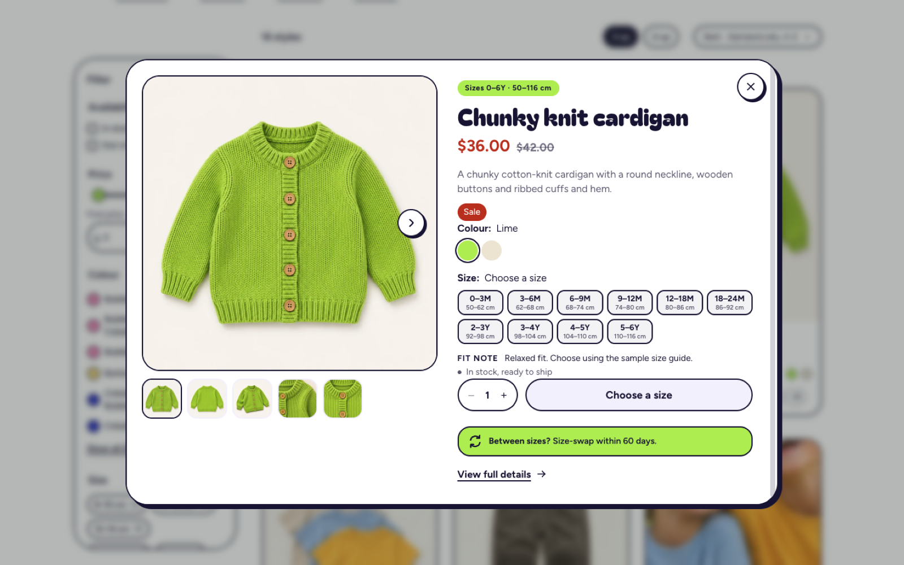

# Quick view, cards and colour swatches

## Product cards

Each card shows the photo, a sale or sold-out badge, the type and age line, the title, the price, colour dots and size chips. On desktop, hovering shows the quick view (eye) button and the add pill.

| Card element | Where to change it |
| --- | --- |
| Image ratio, second image on hover, border radius | Theme settings > Product tiles |
| Colour dots, maximum dots, swatch type | Theme settings > Product tiles > Color swatches |
| Add pill (always or on hover, style, labels) | Theme settings > Product tiles > Quick add |
| Rating (star, score, count) | Theme settings > Product tiles > Show product rating |
| Sale, sold out and tag badges | Theme settings > Product tiles > Badges |
| Size chips | Automatic from the product's size option |

The add pill reads **Add to bag** for a product with one variant, and **Select options** (opening quick view) for products with sizes or colours.

## Quick view

Turn it on in **Theme settings > Product tiles > Enable quick view feature**. The quick view is drawn by the theme's **Product modal** section: gallery, title, price, badges, variant picker with size heights, stock line, quantity and add button, pickup availability, a size-swap banner and a **View full details** link. The quick view has no settings of its own in the editor; it follows your color schemes, typography and product option data.

## Colour swatches

Swatches show the colour of each **Colour** option value. The colour comes from, in order:

1. The swatch set on the option value in Shopify admin (product > option > value > swatch).
2. A line in **Theme settings > Color swatches > Configuration**, written `Name: #hex`.
3. The variant image, when **Swatch type** is **Variant image**.

Multi-colour names like "Oat + Sky" can be mapped to a single colour in the configuration.
