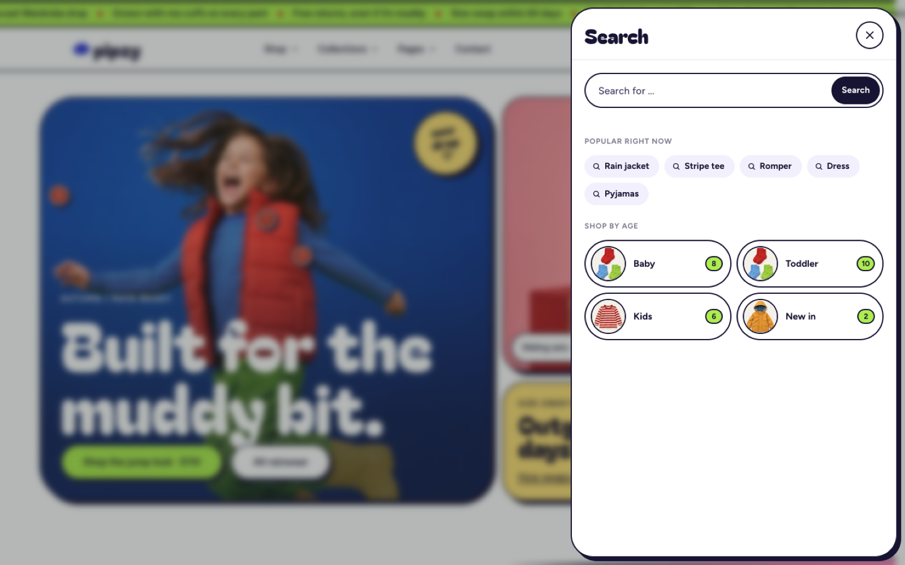
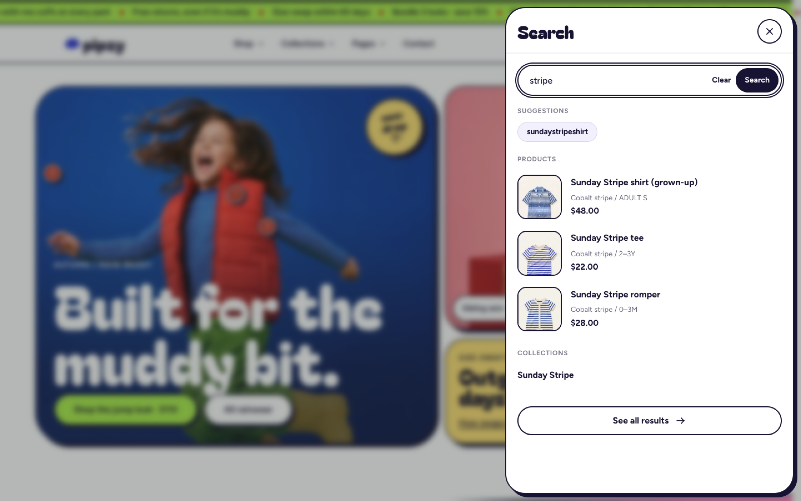
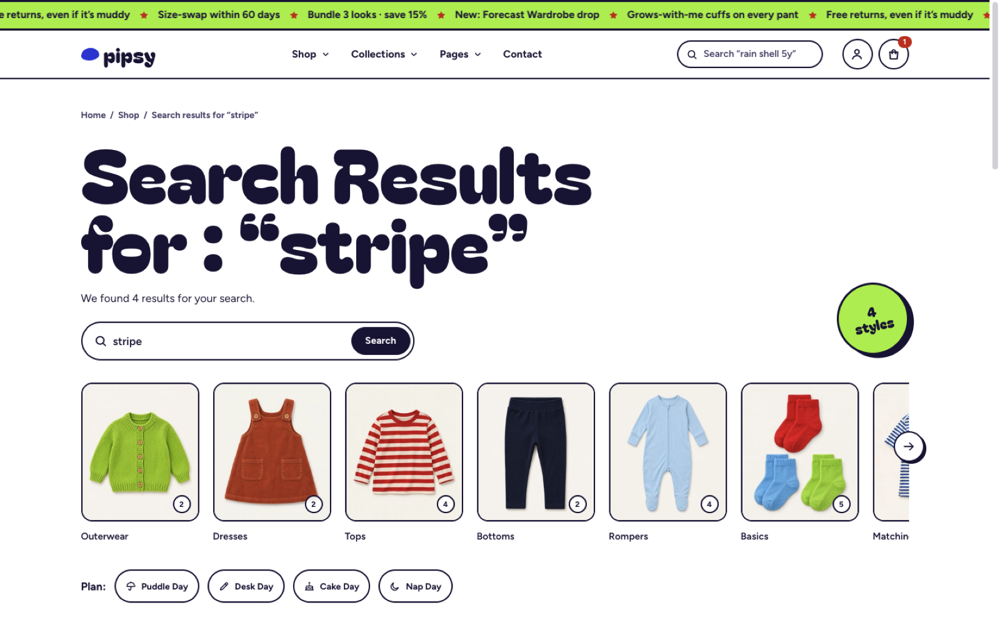

# Search

Shoppers search from the header field, which opens the search drawer, or from the search page.

## Search drawer

As the shopper types, predictive results show suggestions, products, collections and a **See all results** button:

Settings: [Search modal section](../header-footer/drawers-and-popup.md#search-modal-search-drawer) and [Theme settings > Search](../theme-settings/cart-and-search.md#search).

## Search results page

The search template (`templates/search.json`) uses **Catalog intro** (heading with the query, count sticker, search field, collection carousel and plan chips) and **Search results**.

**Search results** settings:

| Setting | What it does |
| --- | --- |
| Description | Text under the heading. |
| Show result types | Product, article and page tabs. |
| Search recommendation, Discovery collections | Shown when there are no results. |
| Suggested products collection / Show suggested products | Products shown with no results. |
| Products per page, columns, gap, pagination | As on the collection page. |
| Filtering and sorting | As on the collection page. |
| Blog post card | Show tags, category, date, comment count, author on article results. |
