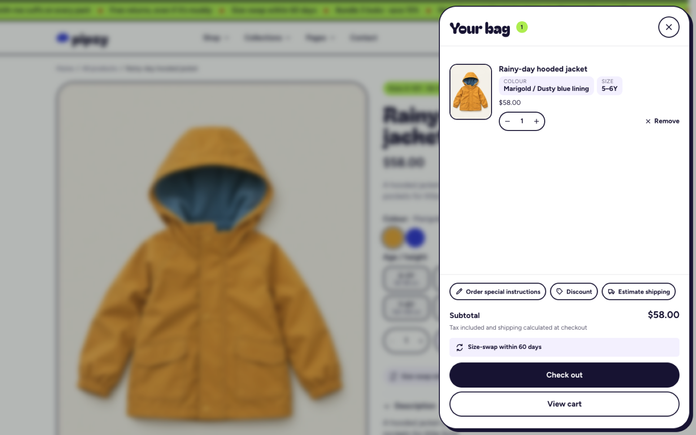
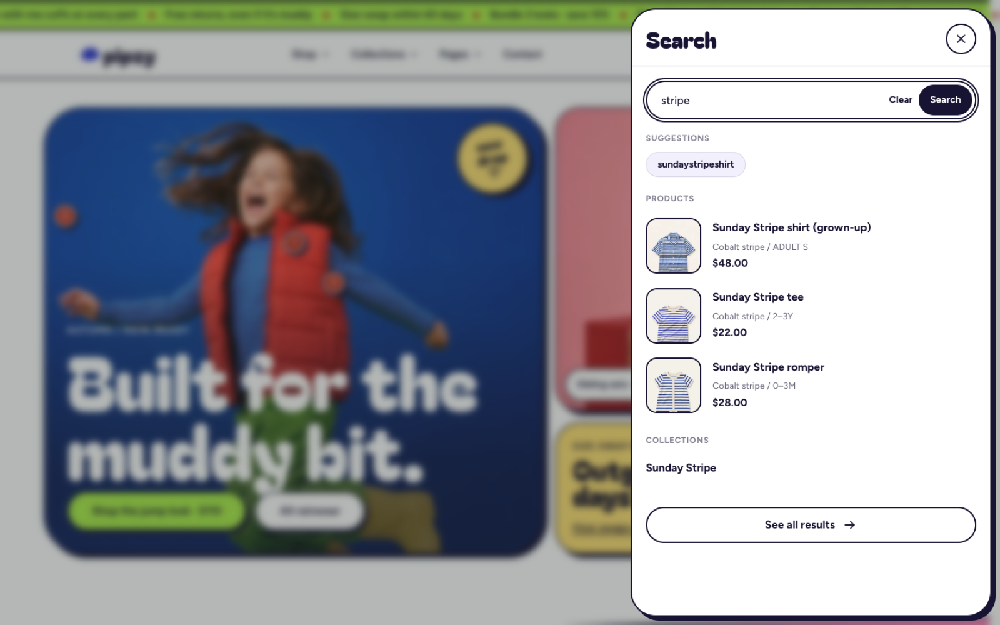

# Cart and search

## Cart

**Theme settings > Cart**

| Setting | Default (demo) | What it does |
| --- | --- | --- |
| Cart type | Drawer | **Drawer** opens the bag drawer when a product is added; **Page** goes to `/cart`. |
| Cart icon | Cart (demo: Bag) | Bag, Minimal bag, Tote bag or Cart. |
| Gift wrapping > Gift wrap product | Blank | Pick a product that represents gift wrap to offer it in the cart. |
| Show gift note | On | A gift message field with gift wrap. |
| Allow gift wrap per product | On | Lets shoppers wrap single items. |
| Gift wrap selection type | Radio buttons | Switch, Checkbox or Radio buttons. |
| Gift wrap settings info | "Please verify that your gift settings are correct." | Help text shown with the options. |

The drawer's own content (heading, promise line, recommendations, free shipping bar) is set in the **Cart drawer** section; see [Cart drawer, search drawer and popup](../header-footer/drawers-and-popup.md).

## Search

**Theme settings > Search**

| Setting | Default | What it does |
| --- | --- | --- |
| Enable search | On | Shows the search field in the header and the search drawer. |
| Predictive search > Enable predictive search | On | Suggestions, products, collections and pages appear as the shopper types. |
| Maximum results to show | 3 | 1–10 per result type. |
| Search recommendation | Blank | A menu of suggested links. |
| Show product vendor / Show product price | Off / On | In predictive results. |
| Typewriter effect > Enable typewriter effect | Off | Animates the placeholder text. |
| Search starter text | Blank | Text typed by the typewriter effect. |

The drawer's popular searches and collection shortcuts are set in the **Search modal** section. See [Search](../shopping/search.md).
