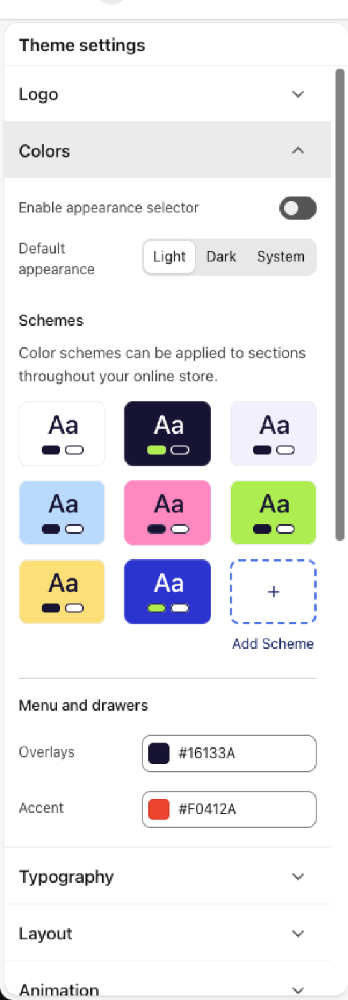

# Colors and color schemes

**Theme settings > Colors**

## Color schemes

Pipsy ships eight schemes. Every section and many blocks have a **Color scheme** setting that points to one of them, so editing a scheme recolours every place that uses it.

| Scheme | Background | Used for in the demo |
| --- | --- | --- |
| Scheme 1 | White | Default pages, cards, header |
| Scheme 2 | Ink (dark navy) | Footer, dark bands, set builder summary bar |
| Scheme 3 | Mist (pale lilac) | Plan chips band, cart drawer, catalog cards |
| Scheme 4 | Sky (light blue) | Set builder, open FAQ questions, quote panels |
| Scheme 5 | Bubble (pink) | Testimonials band, marquee tape, hero photo tile |
| Scheme 6 | Lime | Announcement bar, buttons, size helper band, stickers |
| Scheme 7 | Butter (yellow) | Forecast wardrobe, word swap, hero text tile |
| Scheme 8 | Cobalt (blue) | Hero poster, set builder (spot) |

Each scheme has these colours:

| Group | Colours |
| --- | --- |
| General | Text, Background, Highlight, Muted text, Lines and dividers, Input borders, Keyboard focus, Shadow, Image background |
| Products | Price, Save price, Sale tags, Sale tag text, **Reviews** (star colour) |
| Buttons / Secondary buttons | Text, Background, Border |
| Alerts | Success, Error and Info text and background |
| Overlay color | Overlay |
| Dark palette | Dark-mode versions of the colours above, used when the appearance selector is on |


Keep enough contrast between **Text** and **Background** in each scheme. Pastel grounds in Pipsy are always paired with Ink text.


## Other colour settings

| Setting | Default | What it does |
| --- | --- | --- |
| Enable appearance selector | Off | Lets shoppers switch between light and dark appearance (the switch appears where the header settings allow it). |
| Default appearance | Light | Light, Dark or System. |
| Menu and drawers > Overlays | Ink `#16133A` | The dimmed layer behind drawers, quick view and the search drawer. |
| Menu and drawers > Accent | Tomato `#F0412A` | Accent colour for small highlights such as the bag count. |
