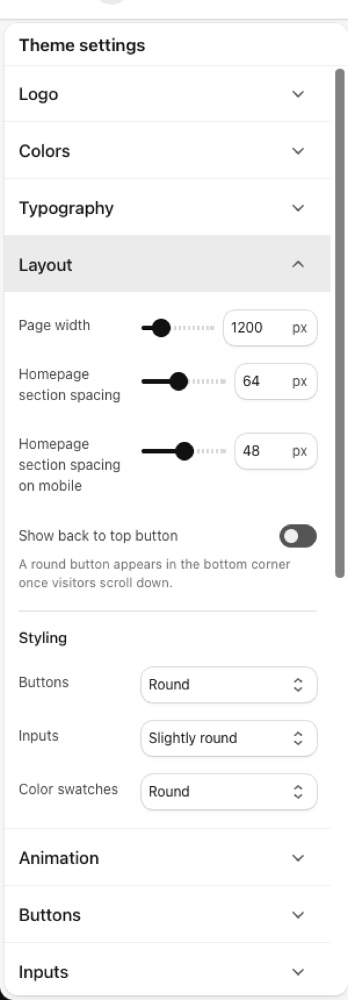

# Layout, animation, buttons and inputs

## Layout

**Theme settings > Layout**

| Setting | Default | What it does |
| --- | --- | --- |
| Page width | 1200 px | 1000–2000 px. Maximum width of boxed sections. |
| Homepage section spacing | 64 px | Space between home sections on desktop. |
| Homepage section spacing on mobile | 48 px | The same on phones. |
| Show back to top button | Off | A round button in the bottom corner once visitors scroll down. |
| Styling > Buttons | Round | Square, Slightly round or Round corners for buttons. |
| Styling > Inputs | Slightly round | Corner style of form fields. |
| Styling > Color swatches | Round | Shape of colour swatches. |

## Animation

**Theme settings > Animation**

| Setting | Default | What it does |
| --- | --- | --- |
| Enable section scroll animations | On | Sections fade and rise in as they scroll into view. Also controls the pinned scroll steps of some home sections. |
| Enable page transition | On | A short fade between pages. |
| Enable image loading bar | On | A thin bar while images load. |


Pipsy respects the visitor's *reduced motion* system setting: pinned scrolling, marquees and scroll effects stop for visitors who ask for less motion.


## Buttons

**Theme settings > Buttons**

| Setting | Default (demo) | What it does |
| --- | --- | --- |
| Secondary button background | Transparent | Solid or transparent outline buttons. |
| Border > Thickness | 1 px in the demo (0–12) | Button border width. |
| Border > Opacity | 100% | |
| Shadow > Opacity, Horizontal offset, Vertical offset | 0 | A hard offset shadow under buttons. |

## Inputs

**Theme settings > Inputs**: **Border > Thickness** (demo 1 px) and **Border > Opacity** (demo 65%) for text fields, selects and text areas.

## Surface style

**Theme settings > Surface style > Material**: **Solid** (default) or **Soft glass**. Applies to navigation, floating controls and panels; content and product photos keep their own colours.
