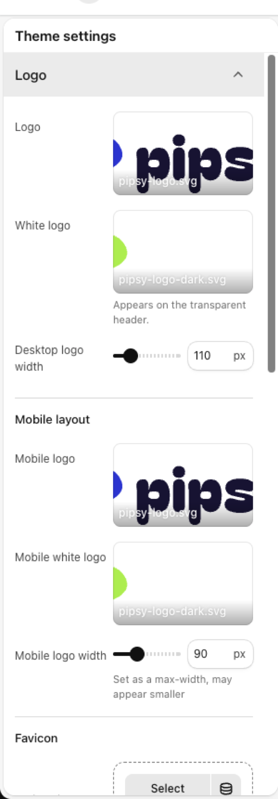

# Logo and favicon

**Theme settings > Logo**

| Setting | What it does |
| --- | --- |
| Logo | Logo image in the header on desktop. SVG or PNG with a transparent background works best. |
| White logo | Used on a transparent header (when the first section allows it). |
| Desktop logo width | 40–400 px. The demo uses 110 px. |
| Mobile logo / Mobile white logo | Optional separate files for phones. Without them the desktop files are used. |
| Mobile logo width | 40–200 px, a maximum width. The demo uses 90 px. |
| Favicon image | Scaled down to 32 × 32 px. |

## Text logo

When no logo is uploaded, the header shows the **Wordmark** text from the **Header** section (default `pipsy`) in the heading font. The footer has its own **Logo**, **Image width** and **Wordmark** settings, so you can use a light logo on the dark footer. See [Footer](../header-footer/footer.md).


The **Enable logo as H1 on home page** setting in the Header section makes the logo the page heading on the home page for search engines. Turn it off only if another home section already has an H1.

