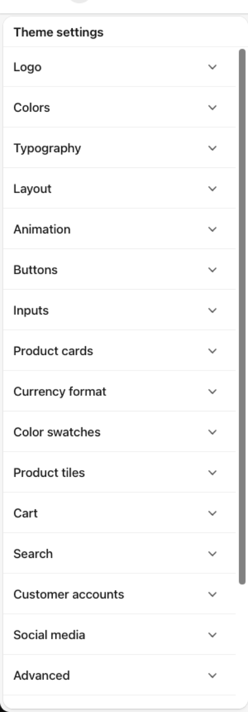

# Theme settings overview

Theme settings apply to the whole store. Open them in the theme editor with the **gear icon** (Theme settings) in the left bar.

| Group | What it controls | Page |
| --- | --- | --- |
| Logo | Logo files, widths, favicon | [Logo and favicon](logo-and-favicon.md) |
| Colors | Color schemes, overlay and accent colours, appearance selector | [Colors](colors.md) |
| Typography | Heading, body, data, navigation, button and product grid fonts; heading size scale; icon weight | [Typography](typography.md) |
| Layout | Page width, home section spacing, back to top button, corner styles | [Layout and style](layout-and-style.md) |
| Animation | Scroll animations, page transition, image loading bar | [Layout and style](layout-and-style.md#animation) |
| Buttons, Inputs | Borders and shadows of buttons and form fields | [Layout and style](layout-and-style.md#buttons) |
| Product cards | Text alignment and border of cards | [Product cards](product-cards.md) |
| Currency format | Currency codes on prices | [Product cards](product-cards.md#currency-format) |
| Color swatches | Colour names mapped to hex colours | [Product cards](product-cards.md#color-swatches) |
| Product tiles | Image ratio, rating, quick view, quick add, swatches, badges | [Product cards](product-cards.md#product-tiles) |
| Cart | Drawer or page, cart icon, gift wrapping | [Cart and search](cart-and-search.md) |
| Search | Predictive search, typewriter effect | [Cart and search](cart-and-search.md#search) |
| Customer accounts | The account menu | [Social media and advanced](social-and-advanced.md#customer-accounts) |
| Social media | Social profile links and share buttons | [Social media and advanced](social-and-advanced.md#social-media) |
| Advanced | Mobile modal close button, link preloading, tab attention | [Social media and advanced](social-and-advanced.md#advanced) |
| Size data | Metafield namespace, units, low stock threshold, fit options | [Social media and advanced](social-and-advanced.md#size-data) |
| Surface style | Solid or soft glass navigation and panels | [Layout and style](layout-and-style.md#surface-style) |


Changes in the editor stay in a draft until you click **Save**. Use the undo arrows at the top of the editor to step back.

