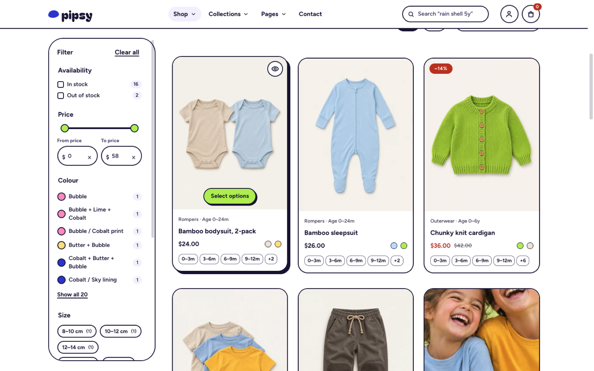
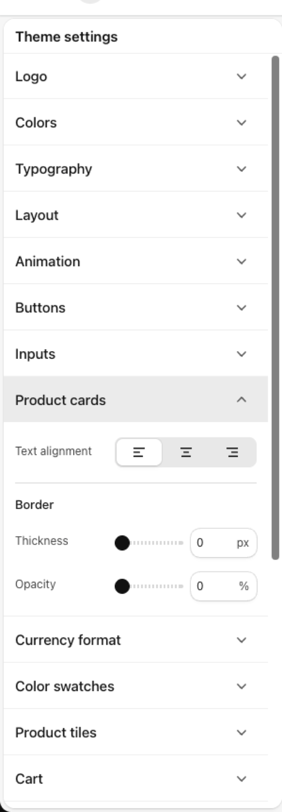
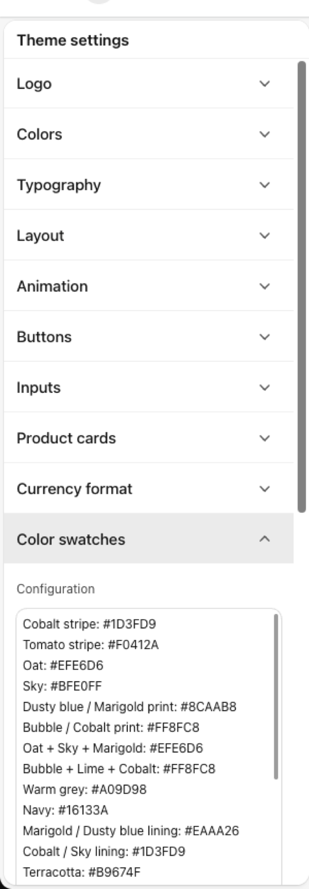
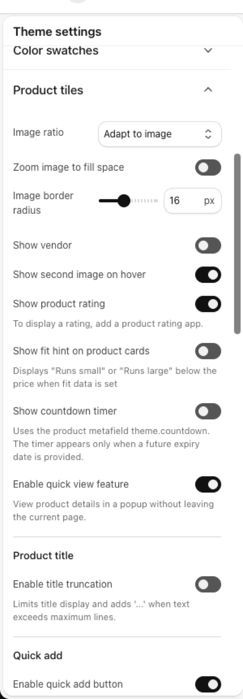

# Product cards, tiles and swatches

These settings control the product cards on collection pages, search results, the home rack, related products and the cart suggestions.

## Product cards

**Theme settings > Product cards**

| Setting | Default | What it does |
| --- | --- | --- |
| Text alignment | Left | Left, center or right text under the photo. |
| Border > Thickness | 0 px | 0–24 px. |
| Border > Opacity | 0% | |

## Currency format

**Theme settings > Currency format > Show currency codes** (off by default). Cart and checkout prices always show codes, for example `$1.00 USD`.

## Color swatches

**Theme settings > Color swatches**

| Setting | What it does |
| --- | --- |
| Configuration | One line per colour, written `Name: #hex`, for example `Cobalt stripe: #1D3FD9`. A product option value with that name shows that colour. |
| Image swatches > Display image swatch tooltip | Shows the colour name when hovering an image swatch. |

Pipsy picks a swatch colour in this order: the swatch set on the option value in Shopify admin (Shopify's own colour swatches), then a line in **Configuration**, then the variant image when the swatch type is **Variant image**.

## Product tiles

**Theme settings > Product tiles**

| Setting | Default (demo) | What it does |
| --- | --- | --- |
| Image ratio | Adapt to image | Adapt, Square, Portrait, Landscape or Wide. |
| Zoom image to fill space | Off | Crops the photo to fill the frame. |
| Image border radius | 16 px | 0–40 px. |
| Show vendor | Off | |
| Show second image on hover | Off (demo: on) | Shows the second product image on hover. |
| **Show product rating** | Off (demo: on) | Shows a star, the average score and the count on cards. Needs a reviews app that fills the `reviews.rating` metafields. Cards without reviews show nothing. See [Product reviews](../product-page/reviews.md). |
| Show fit hint on product cards | On (demo: off) | "Runs small" or "Runs large" below the price when fit data is set. |
| Show countdown timer | On (demo: off) | Uses the product metafield `theme.countdown`; appears only for a future date. |
| Enable quick view feature | On | Adds the eye button that opens [quick view](../shopping/quick-view-and-cards.md). |
| Product title > Enable title truncation | Off | Limits the title to **Maximum lines to display** (1–3). |
| Quick add > Enable quick add button | On | Shows the add pill under the photo. |
| Quick add > Enable quick add by size | Off | Size buttons for products with a single option named Size. |
| Quick add > Add button on desktop | On hover | Always or On hover. Touch screens always show the button. |
| Quick add > Button style | Lime | Lime, Light or Dark pill. |
| Quick add > Add button label / Options button label | Blank | Your own text; blank uses the translated default ("Add to bag", "Select options"). |
| Color swatches > Enable color swatches | On | Colour dots on cards. |
| Color swatches > Maximum swatches to show | 4 | 1–6, the rest show as "+N". |
| Color swatches > Swatch type | Color swatch (demo: Variant image) | Variant image needs an image on every variant. |
| Badges > Show badges vertically | Off | Stacks badges. |
| Badges > Show sold out badge | Off (demo: on) | |
| Badges > Show sale badge | On | |
| Badges > Sale badge style | Percent (demo: Label) | Dollar, Percent or Label. |
| Badges > Badge tag prefix | Blank | With `badge:`, a product tagged `badge:New in` shows a "New in" badge. Blank turns it off. |
| Miscellaneous > Remove the collection portion from product URLs | Off | Shorter product links for SEO. |
