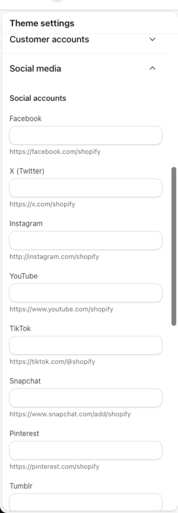
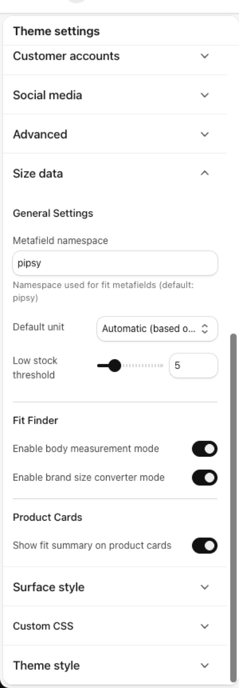

# Social media, accounts, advanced and size data

## Social media

**Theme settings > Social media**

* **Social accounts**: Facebook, X (Twitter), Instagram, YouTube, TikTok, Snapchat, Pinterest, Tumblr, LinkedIn, Vimeo, Discord and LINE. Paste the full profile URL. Filled accounts appear as round icons in the footer (when **Show social media icons** is on in the Footer section), and optionally in the announcement bar and mobile menu.
* **Sharing options**: Share on Facebook, Share on X, Pin on Pinterest, Share on Telegram, Share on WhatsApp, Share by Email. These networks are used by the **Share buttons** product block and the Journal article **Share and links** block.

## Customer accounts

**Theme settings > Customer accounts > Customer account menu** (default `customer-account-main-menu`): the menu shown in the account area. See [Customer accounts](../more-pages/customer-accounts.md).

## Advanced

**Theme settings > Advanced**

| Setting | Default | What it does |
| --- | --- | --- |
| Mobile modals > Show close button | Off | Adds a close button to mobile drawers, in addition to the swipe gesture. |
| Links > Preload links on hover | On | Starts loading a page when the pointer rests on its link. |
| Links > Open external links in a new tab | Off | |
| Tab attention > Enable tab attention | Off | Changes the browser tab title when the shopper switches tab. |
| Message 1 / Message 2 / Message delay | "Something we said?", "We're still here!", 3 s | The texts and timing. |

## Size data

**Theme settings > Size data**

| Setting | Default | What it does |
| --- | --- | --- |
| Metafield namespace | `pipsy` | Namespace of the product fit metafields (for example `pipsy.size_chart`, `pipsy.fit_note`). Change it only if your metafields use another namespace. |
| Default unit | Automatic | Centimetres, inches, or automatic from the store locale. |
| Low stock threshold | 5 | 1–20. |
| Fit Finder > Enable body measurement mode | On | |
| Fit Finder > Enable brand size converter mode | On | |
| Product Cards > Show fit summary on product cards | On | |

How the size data is used is explained in [Size data and the height helper](../product-page/size-data.md).
