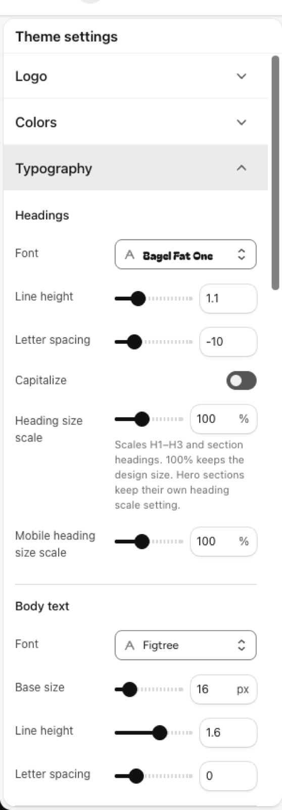

# Typography

**Theme settings > Typography**

## Headings

| Setting | Default | What it does |
| --- | --- | --- |
| Font | Bagel Fat One | Display font for headings, stickers and the text logo. |
| Line height | 1.1 | |
| Letter spacing | −10 | In thousandths of an em. |
| Capitalize | Off | Uppercase headings. |
| Heading size scale | 100% | 70–150%. Scales H1–H3 and section headings on every page. Hero sections keep their own **Heading scale** setting. |
| Mobile heading size scale | 100% | The same on phones. |

## Body text

| Setting | Default |
| --- | --- |
| Font | Figtree |
| Base size | 16 px |
| Line height | 1.6 |
| Letter spacing | 0 |

## Extras

| Setting | Default | What it does |
| --- | --- | --- |
| Data font | Figtree | Used for prices, sizes, measurements, counts and dates. |
| Navigation font / weight / base size | Body, Medium, 16 px | Main menu text. **Capitalize navigation** and **Use secondary color** change its look. |
| Buttons font / weight / base size | Body, Semi-bold, 16 px | **Capitalize buttons** turns on uppercase. |
| Product grid font / weight / base size | Body, Medium, 16 px | Product titles on cards. |
| Icons > Weight | Bold (2.25) | Stroke weight of all line icons: Light, Regular or Bold. |


Fonts come from the Shopify font library, so they load from Shopify's servers and need no upload.

